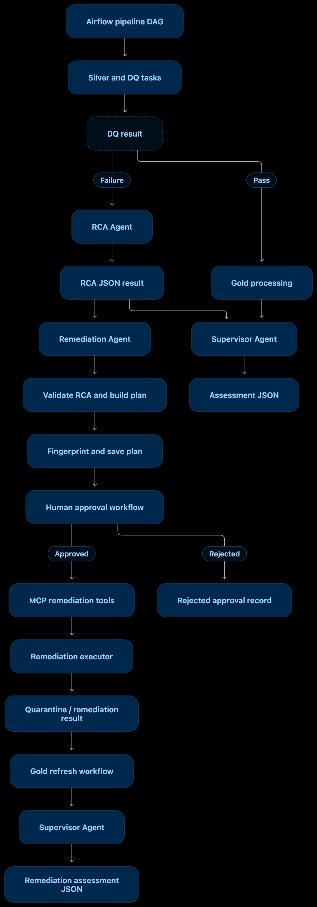

# DataPilot AI — Agent Interactions and Orchestration

**Document path:** `docs/architecture/agent-interactions.md`  
**Primary source reviewed:** Supervisor Agent implementation and Remediation Agent implementation  
**Related components:** RCA Agent, Airflow DAGs, MCP Server, remediation executor, Gold refresh jobs

## 1. Purpose

This document explains how DataPilot AI's RCA, Remediation, and Supervisor agents interact with Airflow and the MCP-based remediation workflow.

The architecture has separate responsibilities:

- **RCA Agent:** investigates a data-quality failure and produces an RCA result.
- **Remediation Agent:** validates an RCA result and creates a fingerprinted remediation plan.
- **Approval workflow:** records an approval or rejection through the MCP/remediation workflow.
- **Remediation executor:** performs the supported remediation operation under the workflow's execution controls.
- **Supervisor Agent:** assesses pipeline and remediation outcomes. It does not approve or execute remediation.

These are coordinated workflows, not one unrestricted autonomous agent chain.

## 2. High-level architecture



**Important interpretation:** The diagram shows the logical responsibilities and workflow relationship. It does not mean the Supervisor calls the Remediation Agent, or that the Remediation Agent directly calls MCP. The supplied Remediation Agent code only reads an RCA JSON file, validates it, creates a plan, fingerprints it, and writes the plan file.

## 3. Agent responsibility boundaries

| Component | Input | Main responsibility | Output / effect |
|---|---|---|---|
| RCA Agent | DQ failure evidence and investigation parameters | Diagnose the root cause and recommend remediation | RCA JSON result |
| Remediation Agent | RCA JSON result | Validate RCA structure and create a remediation plan | Fingerprinted plan JSON with `PENDING_APPROVAL` |
| Approval workflow | Candidate plan and human decision | Record approval or rejection according to workflow controls | Approval/rejection record |
| MCP Server | Tool requests from the remediation workflow | Expose DQ inspection, approval, rejection, audit and execution operations | Tool responses and workflow effects |
| Remediation executor | Authorized remediation request | Run the supported remediation operation | Execution result and audit evidence |
| Supervisor Agent | DQ reports, Airflow task states, RCA results and remediation task outcomes | Assess health and recommend follow-up | Supervisor assessment JSON |

## 4. RCA to Remediation plan flow

### 4.1 RCA result as the Remediation Agent input

The Remediation Agent loads an RCA result from the path supplied through `--rca-result`.

It requires these fields:

- `dataset`
- `dq_status`
- `classification`
- `root_cause`
- `recommendation`
- `remediation`
- `next_actions`
- `confidence`

The validator requires `dq_status` to be `FAIL`. It also validates that the dataset, root cause and recommendation are non-empty strings; `next_actions` is a list; and `remediation` is an object.

### 4.2 Supported remediation actions and confidence

Allowed remediation actions:

- `QUARANTINE_RECORDS`
- `TRANSFORMATION_FIX`
- `UPDATE_DQ_RULE`
- `NO_ACTION`
- `MANUAL_REVIEW`

Allowed confidence values:

- `HIGH`
- `MEDIUM`
- `LOW`

The `remediation` object must include:

- `action`
- `requires_approval` (boolean)
- `reason` (non-empty string)

`UPDATE_DQ_RULE` is explicitly rejected unless `requires_approval` is `true`.

### 4.3 Plan construction

The plan copies the dataset, classification, confidence, DQ status, action, approval requirement, reason, root cause, recommendation and next actions from the RCA result.

It initializes these governance and execution fields:

| Field | Initial value / behavior |
|---|---|
| `status` | `PENDING_APPROVAL` |
| `execution_mode` | `DRY_RUN` |
| `business_justification_required` | `true` only for `UPDATE_DQ_RULE` |
| `rule_change` | `null`; the agent does not invent a new business rule |
| `execution.executed` | `false` |
| `execution.executed_by` | `null` |
| `execution.execution_result` | `null` |

The plan is passed through `attach_plan_fingerprint()` before it is returned and again when saved. The fingerprint implementation is maintained separately in `agents/remediation/plan_fingerprint.py`.

### 4.4 Saving and displaying the plan

The CLI requires:

```text
--rca-result <path>
--output <path>
```

The output directory is created when needed, and the plan is written as JSON with `allow_nan=False`.

**Boundary:** The supplied Remediation Agent code does not call MCP, request human approval, execute a remediation action, or modify source data. It creates the plan artifact for the downstream approval/remediation workflow.

## 5. Supervisor Agent operating modes

The Supervisor implementation contains three assessment entry paths. They should not be conflated.

### 5.1 Standalone read-only assessment: `run_assessment()`

This path:

1. Loads a DQ JSON report.
2. Validates the report's required fields (`dataset`, `status`, `checks`).
3. Summarizes passed, failed and unknown checks.
4. Retrieves recent Airflow DAG runs through `AirflowClient`.
5. If the latest run is failed, collects task attempts and log diagnostics.
6. Makes an independent DQ and pipeline assessment, then combines the decisions.
7. If the DQ assessment decision is `INVOKE_RCA`, invokes the existing RCA Agent as a subprocess.
8. Saves the Supervisor assessment JSON.

The RCA invocation is narrowly scoped. The Supervisor extracts the first supported failed numeric range check matching the expected `range_check:<column>` name and numeric `minimum <= value <= maximum` expression. If no supported failed range check is found, RCA invocation is skipped.

The subprocess uses the current Python interpreter, a 900-second timeout, and writes an RCA result under `results/rca/`.

This standalone path is described as `READ_ONLY`: it does not trigger a DAG or execute remediation. It can invoke RCA, which creates an RCA result artifact.

### 5.2 In-DAG pipeline assessment: `run_dag_assessment()`

This function assesses the current pipeline DAG run using:

- Current Airflow task-instance states.
- DQ reports under `results/dq/`.
- Run-specific RCA reports under `results/rca/<dag_run_id>/`.
- Gold task states for configured Gold datasets.
- The `gold_olist_order_summary` task state.

It checks DQ report freshness against the DQ task start time and marks evidence as missing, stale, unknown, or read-failed when appropriate. RCA results are considered only when the corresponding RCA task succeeded and the run-specific report exists.

Its decision precedence is:

1. Missing, stale or otherwise invalid DQ evidence → `REVIEW_REQUIRED`.
2. Any DQ failure → `DQ_FAILURE_INVESTIGATION_REQUIRED`.
3. Failed pipeline task → `PIPELINE_FAILURE_INVESTIGATION_REQUIRED`.
4. Business summary task not successful → `GOLD_SUMMARY_NOT_COMPLETED`.
5. Otherwise → `PIPELINE_HEALTHY`.

The function records recommended next actions and saves a run-specific assessment under `results/supervisor/`.

**Critical distinction:** `run_dag_assessment()` does not invoke the RCA Agent, trigger DAGs, execute remediation, or approve remediation. It consumes the RCA artifacts already produced by the pipeline's RCA tasks.

### 5.3 In-DAG remediation assessment: `run_remediation_dag_assessment()`

This function assesses a remediation DAG run. It reads the requested mode from `dag_run.conf`, defaulting to `DRY_RUN`, and inspects task states for:

- `execute_remediation_and_write_summary`
- `validate_existing_apply_for_gold`
- `continue_to_gold_only_after_apply`
- `refresh_gold_olist_order_payments`
- `refresh_gold_olist_order_summary`
- `update_postgres_summary_after_gold_refresh`
- `update_postgres_summary_after_gold_failure`

It determines an outcome based on the requested mode:

| Requested mode | Main decision conditions |
|---|---|
| `DRY_RUN` | Successful executor task → `DRY_RUN_COMPLETED_NO_GOLD_REFRESH`; failed/upstream-failed executor → `REMEDIATION_DRY_RUN_FAILED`; otherwise review |
| `APPLY` | Executor must succeed; then payment and summary Gold refresh states determine success, failure or unknown outcome; Postgres summary update is assessed separately |
| `GOLD_REFRESH_ONLY` | Existing APPLY validation must succeed; then Gold refresh and Postgres summary update states determine the result |
| Other | `UNSUPPORTED_REMEDIATION_MODE` |

For DRY_RUN/APPLY, the Supervisor attempts to retrieve the execution ID from the executor task's XCom return value when the executor task succeeded. For GOLD_REFRESH_ONLY, it reads the execution ID from DAG run configuration. XCom retrieval is best-effort and does not fail the assessment.

The function saves a run-specific assessment under `results/supervisor/remediation/`.

**Boundary:** This function observes task states and execution metadata. It does not execute remediation, grant approval, trigger a DAG, or modify source data.

## 6. Supervisor decision logic

### 6.1 DQ assessment

`assess_dq()` counts PASS, FAIL and unknown checks.

- Unknown overall DQ status or unknown check statuses → `REVIEW_REQUIRED`.
- DQ status FAIL or one or more failed checks → `INVOKE_RCA`.
- Otherwise → `DQ_PASSED`.

### 6.2 Standalone combined decision

`make_decision()` treats DQ and pipeline status as independent signals. It distinguishes pipeline in-progress, failed, successful and unknown states, then combines those with the DQ decision.

Examples of combined decisions include:

- `INVOKE_RCA_AND_INVESTIGATE_PIPELINE`
- `PIPELINE_IN_PROGRESS_WITH_DQ_FAILURE`
- `INVOKE_RCA`
- `INVESTIGATE_PIPELINE_FAILURE`
- `PIPELINE_IN_PROGRESS`
- `PIPELINE_HEALTHY`
- `REVIEW_REQUIRED`

### 6.3 In-DAG pipeline decision

The in-DAG decision uses current-run evidence and the explicit precedence documented in section 5.2. It is not the same function as the standalone `make_decision()` path.

### 6.4 Remediation decision

The remediation assessment uses the remediation DAG's requested mode and monitored task states. It reports whether the dry run completed, APPLY execution and Gold refresh succeeded, Gold refresh failed, or evidence is incomplete.

## 7. MCP and human approval boundary

The broader remediation workflow uses MCP tools for inspection, approval/rejection, audit and execution. The previously documented MCP interface includes:

1. `get_dq_result`
2. `inspect_bronze`
3. `inspect_silver`
4. `get_invalid_records`
5. `get_remediation_audit`
6. `approve_remediation`
7. `reject_remediation`
8. `execute_remediation`

The Remediation Agent code documented here does not call these tools directly. Its output plan is a separate artifact consumed by the approval/remediation workflow.

The existing workflow has additional safeguards and scope restrictions documented in `docs/operations/mcp-tools.md` and `docs/operations/remediation-workflow.md`. Consult those documents for exact approval-scope and executor behavior; do not infer that a `PENDING_APPROVAL` plan is itself authorization to execute.

## 8. LangSmith tracing and data minimization

The Supervisor's pipeline and remediation assessment functions are decorated with LangSmith `@traceable`.

The trace input processor allowlists operational metadata such as DAG ID, DAG run ID, supported run mode and table counts. The output processor emits a limited summary such as assessment type, decision, task counts, failed task counts and remediation mode/execution-ID status.

The code intentionally avoids sending the full Supervisor assessment into the trace output. The trace processors are an observability boundary, not an execution mechanism.

## 9. Output artifacts

| Assessment / artifact | Output location |
|---|---|
| Standalone Supervisor assessment | Default: `results/supervisor/assessment.json` |
| In-DAG pipeline Supervisor assessment | `results/supervisor/<sanitized_dag_run_id>_assessment.json` |
| In-DAG remediation Supervisor assessment | `results/supervisor/remediation/<sanitized_dag_run_id>_assessment.json` |
| Remediation plan | CLI-supplied `--output` path |
| Pipeline RCA result | Run-specific `results/rca/<dag_run_id>/<dataset>.json` |
| Standalone Supervisor-invoked RCA result | `results/rca/<dataset>_supervisor_rca.json` |

## 10. Safety and operational boundaries

- The Remediation Agent validates and writes a plan; it does not approve or execute it.
- The Supervisor assesses evidence and task outcomes; it does not approve remediation or execute remediation.
- The standalone Supervisor path may invoke the RCA Agent for a supported failed numeric range check.
- The in-DAG pipeline Supervisor path consumes current-run RCA output; it does not invoke RCA itself.
- The remediation Supervisor path assesses executor, validation, Gold refresh and summary-update task outcomes.
- Approval and execution controls belong to the separate remediation workflow and MCP/executor components.
- A Supervisor assessment is an operational report, not an authorization to rerun or apply a remediation.
- Post-execution Gold refresh success and Postgres summary update success are distinct outcomes.

## 11. Related documentation

- `docs/agents/rca-agent.md`
- `docs/agents/remediation-agent.md`
- `docs/agents/supervisor-agent.md`
- `docs/operations/mcp-tools.md`
- `docs/operations/remediation-workflow.md`
- `docs/pipeline/pipeline-orchestration.md`
- `docs/pipeline/gold-processing.md`

## 12. Maintenance

Update this document when agent input/output contracts, Supervisor decision rules, Airflow task IDs, assessment paths, MCP tool names, approval scope, remediation execution modes, or LangSmith trace allowlists change.

Keep the standalone Supervisor assessment, in-DAG pipeline assessment, and in-DAG remediation assessment documented as separate execution paths.
