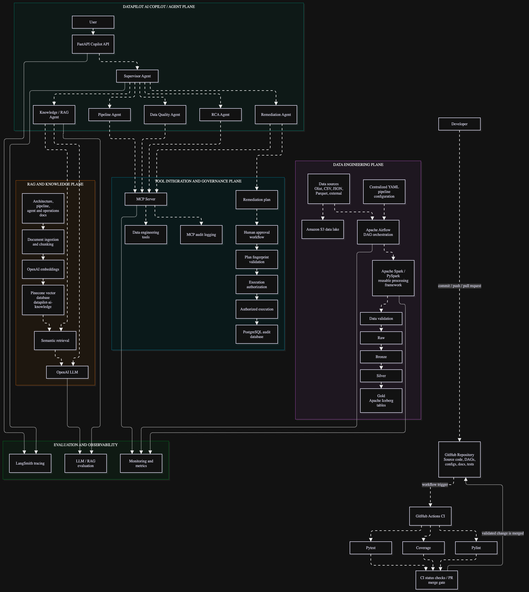

# DataPilot AI --- High-Level Design (HLD)

**Version:** 1.0 \| **Status:** Portfolio implementation \| **Purpose:**
Describe the system context, architectural layers, major components and
their relationships.

## 1. Overview

DataPilot AI combines a configuration-driven data engineering platform
with an AI Copilot. The data plane uses Apache Airflow, Apache Spark,
Amazon S3 and Apache Iceberg. The AI control plane uses FastAPI, a
Supervisor Agent and specialist agents. The knowledge plane uses
document ingestion, OpenAI embeddings and Pinecone. MCP exposes
data-engineering tools, while governed remediation uses explicit
approval, fingerprint validation and PostgreSQL audit records.

GitHub is the source-control home for the project. GitHub Actions
validates repository changes through separate test, coverage and lint
jobs. CI validates code; it does not orchestrate runtime data pipelines.

## 2. HLD architecture diagram

## 3. Architectural planes

  -----------------------------------------------------------------------
  Plane                   Main components         Responsibility
  ----------------------- ----------------------- -----------------------
  Source control and CI   GitHub, GitHub Actions, Version control and
                          Pytest, Coverage,       automated validation
                          Pylint                  

  Data engineering        Airflow, YAML, Spark,   Orchestrate, process
                          S3, Iceberg             and store data

  AI control              FastAPI, Supervisor     Interpret requests and
                          Agent, specialist       coordinate work
                          agents                  

  Knowledge               Document ingestion,     Ground responses in
                          OpenAI embeddings,      project documentation
                          Pinecone, retrieval     

  Tool integration and    MCP, tools, approval    Execute supported tools
  governance              workflow, fingerprint   and govern remediation
                          validation, PostgreSQL  

  Evaluation and          LangSmith, LLM/RAG      Trace and assess AI and
  observability           evaluation, monitoring  pipeline behavior
  -----------------------------------------------------------------------

## 4. Major component responsibilities

-   **GitHub:** Version-controls application code, DAGs, configuration,
    tests, documentation and container definitions.
-   **GitHub Actions:** Runs CI checks; it is not the runtime
    orchestrator.
-   **Airflow:** Schedules and coordinates data pipeline tasks.
-   **Spark:** Performs distributed ingestion and transformation.
-   **S3 and Medallion layers:** Store data across Raw, Bronze, Silver
    and Gold.
-   **FastAPI Copilot:** Exposes the AI interaction interface.
-   **Supervisor Agent:** Routes and coordinates specialist agent work.
-   **Specialist agents:** Handle pipeline, data quality, RCA,
    remediation and knowledge tasks.
-   **Pinecone:** Stores and retrieves document vectors.
-   **MCP Server:** Exposes supported data engineering tools to agents.
-   **Governed remediation:** Separates plan creation from approval and
    authorized execution.
-   **PostgreSQL:** Persists remediation audit information.
-   **LangSmith and evaluation:** Support tracing and evaluation.

## 5. Key architecture decisions

  Concern                  Decision
  ------------------------ --------------------------
  Workflow orchestration   Apache Airflow
  Distributed processing   Apache Spark / PySpark
  Data lake                Amazon S3
  Gold table format        Apache Iceberg
  Copilot API              FastAPI
  LLM                      OpenAI
  Embedding model          `text-embedding-3-small`
  Vector database          Pinecone
  Tool integration         MCP
  Audit persistence        PostgreSQL
  LLM observability        LangSmith
  CI                       GitHub Actions

Pinecone index: `datapilot-ai-knowledge`; dimension: 1536; namespace:
`datapilot-ai`.

## 6. Runtime and deployment boundary

The project runs locally using Docker Compose. The local runtime
includes Airflow services, Spark services, PostgreSQL, the MCP server
and the Copilot API. AWS production deployment and CD are intentionally
outside the current portfolio scope.

## 7. Security and governance principles

-   Keep credentials outside source control.
-   Validate incoming requests and tool arguments.
-   Treat retrieved content and model output as untrusted input.
-   Separate remediation planning from execution.
-   Require approval, matching plan fingerprint and explicit execution
    authorization before an authorized write operation.
-   Record remediation outcomes in the audit store.
-   Do not treat a pending plan or dry run as authorization to modify
    data.

## 8. HLD assumptions and boundaries

This is a logical design, not a production deployment specification.
Exact API routes, database column names, MCP tool schemas, IAM policies
and network security rules must be taken from the implementation before
being documented as concrete interfaces. Functional completion within
the portfolio scope does not imply production readiness.
