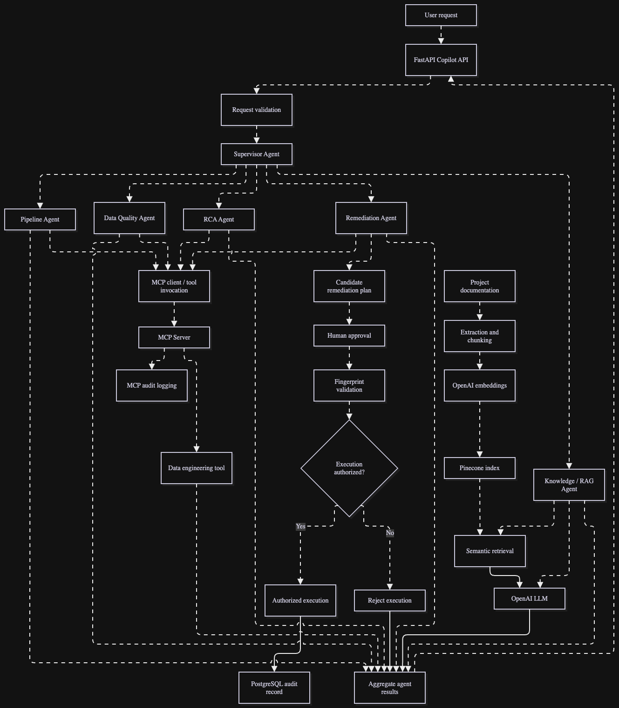
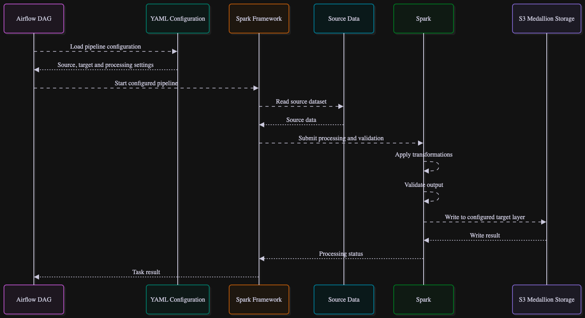
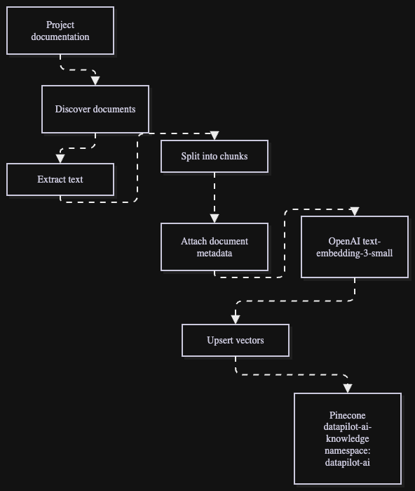
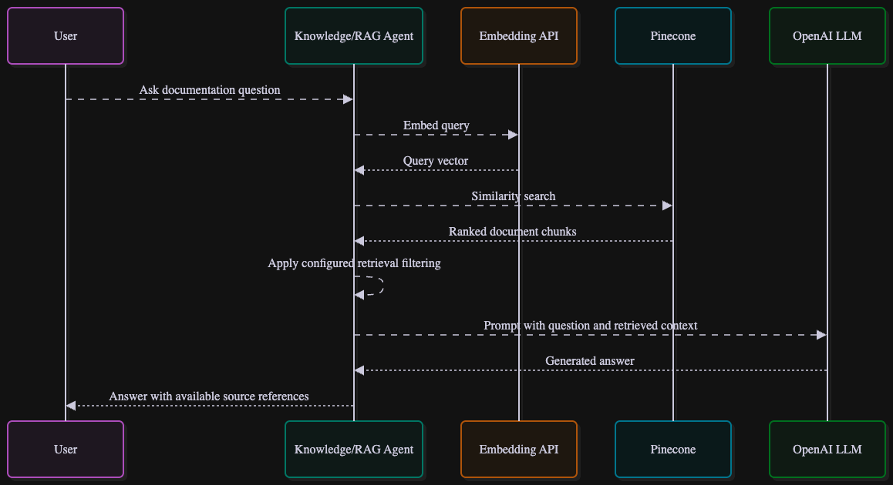
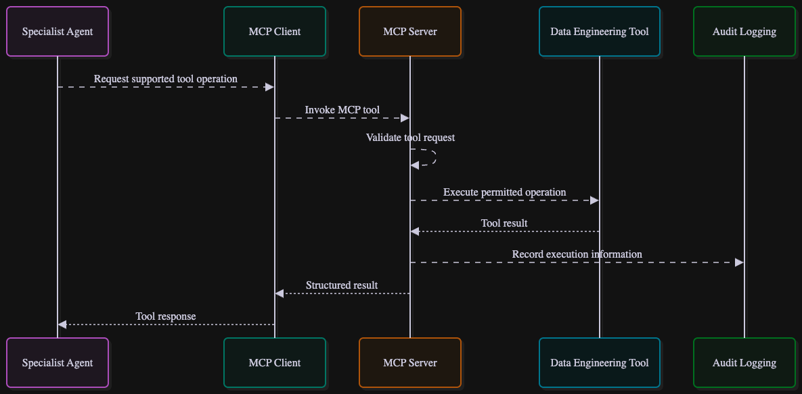
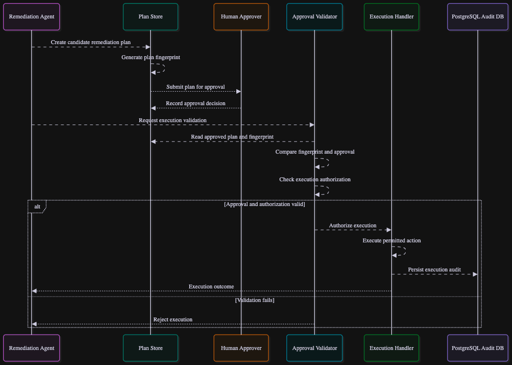
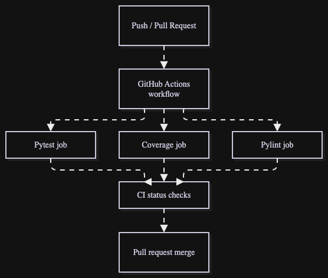

# DataPilot AI --- Low-Level Design (LLD)

**Version:** 1.0 \| **Status:** Portfolio implementation \| **Purpose:**
Describe component-level flows, module boundaries, data movement, agent
interactions, RAG processing, MCP invocation and governed remediation.

## 1. Implementation view

This LLD decomposes the logical HLD into implementation flows. It
documents the known project design while avoiding assumptions about
exact route names, class names, database columns or tool schemas where
those details must be confirmed against source code.

## 2. Repository and module boundaries

  Module                        Responsibility
  ----------------------------- ------------------------------------------------------------
  `dags/`                       Airflow DAG definitions
  `framework/`                  Reusable Spark processing framework
  `config/`                     Centralized YAML configuration
  `agents/`                     Supervisor and specialist agent implementation
  `copilot/`                    FastAPI, RAG ingestion and retrieval
  `mcp_server/`                 MCP server and tool integration
  `tests/`                      Automated tests
  `docs/`                       Architecture, agent, pipeline and operations documentation
  `docker/` and Compose files   Local runtime definitions

Align these logical names with the exact paths in the current repository
before treating this table as a literal directory listing.

## 3. Detailed component interaction diagram




## 4. Data pipeline LLD

### 4.1 Pipeline execution sequence




### 4.2 Medallion layer responsibilities

  -----------------------------------------------------------------------
  Layer                   Processing              Expected output
                          responsibility          
  ----------------------- ----------------------- -----------------------
  Raw                     Preserve source input   Original source
                                                  representation

  Bronze                  Ingest and standardize  Ingested dataset

  Silver                  Clean and transform     Curated dataset

  Gold                    Apply business-level    Analytical Iceberg
                          transformations         tables
  -----------------------------------------------------------------------

### 4.3 Configuration-driven processing

Pipeline behavior is controlled through centralized YAML configuration.
The following is illustrative; the real configuration contract is
defined by the project's configuration loader.

``` yaml
pipeline:
  name: olist_orders
  source:
    type: s3
    format: csv
  target:
    storage: s3
    layer: bronze
    format: parquet
  processing:
    enable_validation: true
```

The framework should validate required fields, supported formats and
layer names before submitting processing work.

## 5. Copilot and agent LLD

### 5.1 Request lifecycle

1.  FastAPI receives a user request.
2.  The API validates the request.
3.  The Supervisor Agent interprets the request.
4.  The Supervisor selects one or more specialist agents.
5.  Agents use RAG or MCP tools when needed.
6.  The Supervisor collects agent results.
7.  The Copilot returns a consolidated response.

### 5.2 Agent responsibility matrix

  ------------------------------------------------------------------------
  Agent             Input              Main processing   Output
  ----------------- ------------------ ----------------- -----------------
  Supervisor        User intent and    Route and         Consolidated
                    context            coordinate work   result

  Pipeline          Pipeline-related   Investigate       Pipeline findings
                    request            supported         
                                       pipeline context  
                                       and operations    

  Data Quality      Quality request or Analyze           Quality findings
                    findings           validation        
                                       results           

  RCA               Failure context    Correlate         RCA result
                    and evidence       evidence and      
                                       infer probable    
                                       cause             

  Remediation       Identified issue   Create plan and   Plan or execution
                    and proposed       govern execution  result
                    action                               

  Knowledge/RAG     Documentation      Retrieve relevant Knowledge answer
                    question           chunks and        
                                       generate grounded 
                                       response          
  ------------------------------------------------------------------------

Exact agent method signatures and inter-agent message schemas are
implementation-specific and should be taken from source code.

## 6. RAG LLD

### 6.1 Ingestion flow




### 6.2 Retrieval flow




### 6.3 Current ingestion baseline

  Metric                   Recorded project result
  ---------------------- -------------------------
  Documents loaded                              14
  Chunks created                               316
  Embeddings generated                         316
  Vectors upserted                             316
  Embedding dimension                         1536
  Pinecone namespace                `datapilot-ai`

These are recorded project results, not a guarantee of the current live
index state.

## 7. MCP LLD

### 7.1 Tool invocation sequence




Tool catalog, request schemas, response schemas and audit event fields
must match the actual MCP implementation. Tool invocation must not
bypass remediation authorization controls.

## 8. Governed remediation LLD

### 8.1 Approval and execution sequence



### 8.2 Execution guard conditions

Execution must be rejected unless all required checks pass:

-   A remediation plan exists.
-   Approval is valid and applies to the plan.
-   The approved fingerprint matches the current plan fingerprint.
-   Explicit execution authorization is present.
-   The requested operation is permitted.

### 8.3 Execution modes

  -----------------------------------------------------------------------
  Mode                                Behavior
  ----------------------------------- -----------------------------------
  `DRY_RUN`                           Validate and report intended
                                      changes without applying them

  `APPLY`                             Perform the operation only after
                                      required approval and authorization
                                      checks
  -----------------------------------------------------------------------

A `PENDING_APPROVAL` status is not execution authorization. A dry run is
not permission to apply changes.

## 9. API and service boundary

The Copilot API is available locally through FastAPI Swagger UI at
`http://localhost:8001/docs`.

Before adding an API contract table, extract actual route paths, HTTP
methods, Pydantic request and response models, authentication
requirements and error responses from the current FastAPI source. Do not
infer route names from conceptual capabilities.

## 10. Local runtime and service integration

The Docker Compose environment contains the project's local runtime
services, including Airflow API server, scheduler, DAG processor and
triggerer; Spark master, worker and development container; PostgreSQL;
MCP server; and Copilot API.

  Service              Local endpoint
  -------------------- ------------------------------
  Airflow              `http://localhost:8080`
  Spark UI             `http://localhost:8081`
  MCP server           `http://localhost:8000`
  Copilot Swagger UI   `http://localhost:8001/docs`

Exact service names, health checks, dependencies, volumes and
environment variables are defined in the current Compose files.

## 11. CI LLD




Configured lint command:

``` bash
PYTHONPATH=. pylint copilot agents mcp_server \
  --fail-under=8.0 \
  --output-format=colorized
```

CI validates repository changes. It does not deploy the application or
replace Airflow runtime orchestration.

## 12. Error handling and validation points

  -----------------------------------------------------------------------
  Boundary                            Validation / failure handling
  ----------------------------------- -----------------------------------
  API request                         Validate request shape and required
                                      fields

  Agent routing                       Handle unsupported or ambiguous
                                      requests

  LLM call                            Handle provider errors and invalid
                                      responses

  RAG retrieval                       Handle empty results and
                                      vector-store errors

  MCP invocation                      Validate tool arguments and handle
                                      tool failures

  Spark execution                     Capture processing errors and
                                      return task status

  S3 write                            Handle storage errors and
                                      incomplete writes

  Remediation                         Reject approval, fingerprint or
                                      authorization mismatches

  Audit persistence                   Surface audit-write failures and
                                      apply safe execution controls
  -----------------------------------------------------------------------

## 13. Security implementation notes

-   Do not store secrets in Git.
-   Load credentials from the local environment or approved secret
    source.
-   Validate agent tool requests at the server boundary.
-   Do not allow model output alone to authorize data changes.
-   Keep plan generation, approval and execution as separate steps.
-   Record governed execution outcomes.
-   Use least privilege for external service credentials.
-   Review API authentication and authorization before production
    exposure.

