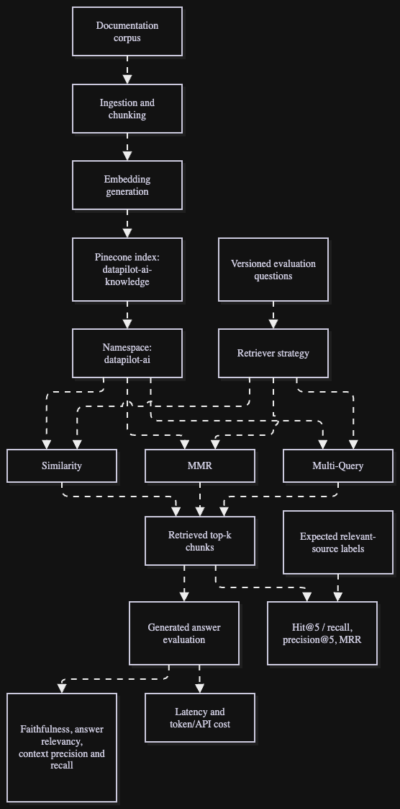

# DataPilot AI – RAG Retrieval Evaluation

## 1. Purpose

This document summarizes the available retrieval evaluation for the DataPilot AI Copilot. It separates retrieval performance from generated-answer quality and records limitations that affect interpretation.

## 2. Knowledge-base ingestion evidence

A previously reported live ingestion run recorded:

| Measure | Reported result |
|---|---:|
| Documents loaded | 14 |
| Chunks created | 316 |
| Embeddings generated | 316 |
| Vectors upserted | 316 |
| Dry run | `false` |
| Pinecone index | `datapilot-ai-knowledge` |
| Dimension | 1536 |
| Namespace | `datapilot-ai` |

These values describe that ingestion run, not a guarantee of the current remote index contents. Confirm current Pinecone statistics before using them as live-state evidence.

## 3. Retrieval experiment design

The previously reported benchmark used 16 questions and compared three retrieval strategies:

- Similarity retrieval.
- Maximum Marginal Relevance (MMR).
- Multi-Query retrieval.

The reported experiment evaluated retrieval using measures including recall/Hit@5, precision@5, and mean reciprocal rank (MRR). The benchmark is small and should be treated as an engineering comparison rather than a statistically conclusive evaluation.

## 4. Reported findings

The previously shared results indicated:

- Multi-Query achieved 100% recall in that 16-question experiment.
- Multi-Query precision@5 was 25% in that experiment.
- MMR achieved the highest reported MRR, 0.825.
- A threshold sweep found that a 0.70 similarity threshold returned no result for 14 questions, while 0.40 retained full Hit@5 in the reported sweep.

These findings show a tradeoff between retrieving relevant evidence and ranking a compact set of useful chunks. They do not establish that one strategy is universally best.

## 5. Interpretation

- **Recall:** Multi-Query retrieved at least one relevant result for each benchmark question in the reported run. Its lower precision@5 indicates that the top-five result set also contained non-relevant chunks.
- **Ranking:** MMR produced the strongest reported MRR, meaning relevant material tended to appear earlier in the ranked results for this benchmark.
- **Thresholding:** A high threshold can suppress useful results. Threshold selection should be based on a versioned evaluation set and the desired balance between abstention and retrieval coverage.

The results should be re-run with the same dataset, expected-source labels, retriever settings, and metric implementation before making a new strategy decision.

## 6. Important limitations

The available evaluation notes identify these limitations:

1. Retrieval latency and cost were not measured.
2. Multi-Query was compared at retrieval level; generated answers were not evaluated in that run.
3. Earlier RAGAS results were from a separate evaluation and cannot be attributed to Multi-Query.
4. The live API retriever configuration must be aligned with the evaluator configuration before production comparisons.
5. Faithfulness, answer relevancy, context precision, and context recall require a consistent RAGAS evaluation run.
6. The evaluation dataset and expected-source labels should be versioned, with explicit regression criteria.

## 7. Recommended next evaluation

For the next evaluation cycle:

- Version the 16-question dataset and expected source labels.
- Record chunker version, embedding model, index configuration, namespace, retrieval strategy, top-k, threshold, and MMR parameters.
- Align evaluator and live API settings.
- Report per-question retrieval results as well as aggregate metrics.
- Measure retrieval latency and token/API cost.
- Evaluate generated answers separately using a fixed answer-quality protocol and RAGAS metrics where appropriate.
- Define minimum regression thresholds before changing the production/default retrieval strategy.

## 8. Conclusion

The available experiment provides useful comparative evidence: Multi-Query favored recall, while MMR produced the best reported ranking metric. The experiment is not sufficient on its own to select a production strategy because cost, latency, generated-answer quality, and regression behavior were not fully measured. Keep the current strategy choice explicit and evidence-driven rather than presenting the benchmark as a completed production optimization.

## 9. RAG Evaluation Architecture

This separates retrieval evaluation from answer evaluation. The reported Multi-Query experiment evaluated retrieval, not generated-answer quality.

## 10. Retrieval Metric Definitions

| Metric | Meaning |
|---|---|
| Hit@5 | Whether at least one relevant item appears in top five |
| Recall@5 | Fraction of expected relevant items retrieved in top five |
| Precision@5 | Fraction of top-five results that are relevant |
| MRR | Average reciprocal rank of the first relevant result |

The benchmark notes refer to recall/Hit@5. Record the exact metric implementation and aggregation method; Hit@5 and Recall@5 need not be interchangeable when a question has multiple expected sources.

## 11. Historical Experiment Findings

The 16-question benchmark reported:
- Multi-Query recall: 100%.
- Multi-Query precision@5: 25%.
- MMR highest reported MRR: 0.825.
- Threshold 0.70 returned no result for 14 questions; threshold 0.40 retained full Hit@5.

This suggests a coverage/precision tradeoff in that small benchmark. It is an engineering comparison, not statistically conclusive evidence or a universal strategy ranking.

## 12. Retrieval versus Answer Evaluation

### Retrieval evaluation

Requires a fixed question set, expected relevant-source labels, retrieval strategy, top-k, threshold and consistent metric implementation. It answers whether the expected evidence was retrieved and how highly it ranked.

### Generated-answer evaluation

Must be a separate, controlled run with fixed prompt/model/retriever configuration. The available notes identify RAGAS measures: faithfulness, answer relevancy, context precision and context recall. Earlier RAGAS results came from a separate evaluation and must not be attributed to the Multi-Query benchmark.

## 13. Reproducibility Record

| Dimension | Record |
|---|---|
| Dataset | Evaluation question-set version |
| Ground truth | Expected-source labels/version |
| Corpus | Document snapshot/revision |
| Chunking | Chunker version and parameters |
| Embeddings | Model and dimensions |
| Vector store | Pinecone index and namespace |
| Retrieval | Strategy, top-k, threshold, MMR parameters |
| Generation | Model and prompt version for answer evaluation |
| Metrics | Definitions and aggregation |
| Runtime | Latency and token/API cost |
| Results | Per-question evidence and aggregate scores |

A previously reported ingestion run loaded 14 documents, created 316 chunks, generated 316 embeddings and upserted 316 vectors to the 1536-dimensional `datapilot-ai-knowledge` index in namespace `datapilot-ai`. These are historical run values; verify current Pinecone statistics before treating them as live state.

## 14. Evaluation Decision Framework

Do not choose a retriever using one aggregate metric. Recall matters when missing evidence is costly; precision matters when context budget and irrelevant chunks are constraints; MRR matters when the first relevant result's rank is important. Evaluate thresholding together with abstention rate and coverage. Measure latency and API/token cost before selecting a default.

## 15. Regression and Change Management

Before changing retrieval strategy, threshold, chunking or embedding model:
1. Run the versioned retrieval benchmark.
2. Compare per-question results as well as aggregate scores.
3. Review regressions on previously answered questions.
4. Run separate generated-answer evaluation.
5. Measure latency and cost.
6. Record configuration and evidence.
7. Define regression acceptance thresholds before promotion.

The supplied notes do not specify numeric acceptance thresholds; they must be set by the project owner rather than invented.
