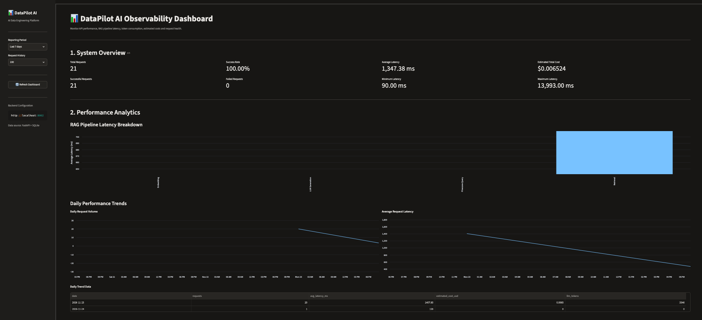
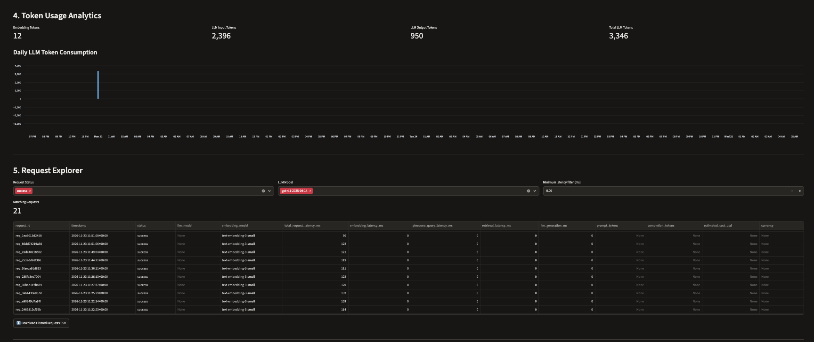
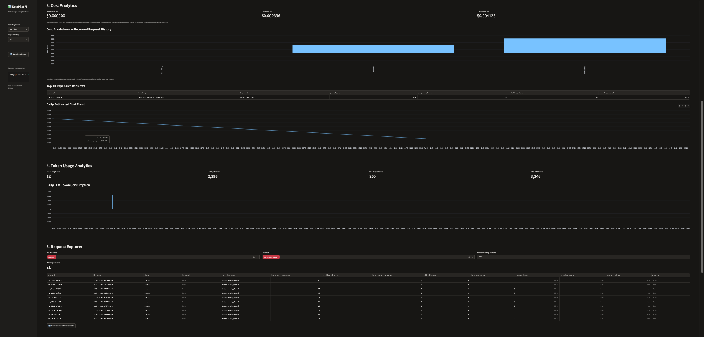
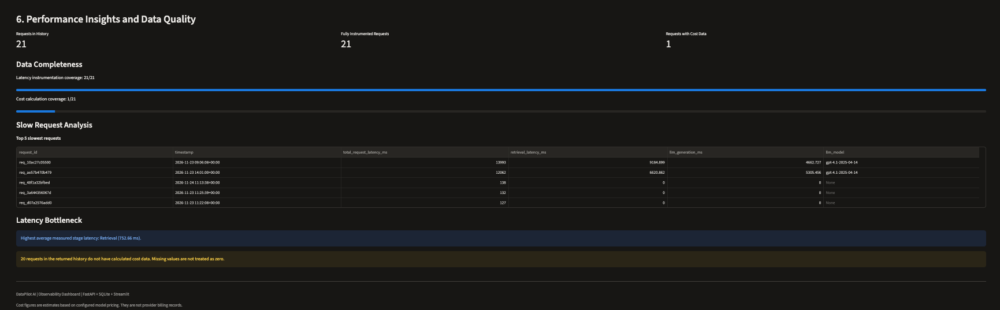

# DataPilot AI — Latency, Token Usage and Cost Observability

**Status:** Implemented and validated  
**Version:** V1  
**Scope:** Local-first RAG API observability  
**Technology:** FastAPI, Python, SQLite, Streamlit, OpenAI and Pinecone

---

## 1. Overview

DataPilot AI includes a local observability framework to measure and monitor RAG API performance, token consumption and estimated LLM operating costs.

The objectives are to provide visibility into:

- End-to-end API request latency.
- Individual RAG pipeline stage latency.
- OpenAI embedding and LLM token consumption.
- Estimated embedding and LLM costs.
- Request success and failure statistics.
- Historical performance and cost trends.

The observability implementation is integrated into the existing DataPilot AI Copilot API.


*Figure: DataPilot AI Observability Dashboard – system overview and request statistics.*

## 2. Architecture

The observability architecture consists of four main components.

### 2.1 Request instrumentation

FastAPI captures request-level execution metrics using Python's `time.perf_counter()`.

| Metric | Description |
|---|---|
| Total request latency | Overall API execution duration |
| Embedding latency | Time spent generating query embeddings |
| Pinecone query latency | Vector database query duration |
| Retrieval latency | Overall RAG retrieval duration |
| LLM generation latency | Time taken by the LLM response generation |

### 2.2 Token usage tracking

Token usage is captured from OpenAI API responses.

| Metric | Description |
|---|---|
| Embedding tokens | Tokens consumed during embedding generation |
| Prompt tokens | LLM input tokens |
| Completion tokens | LLM output tokens |
| Total tokens | Total LLM token consumption |




### 2.3 Cost calculation

`OpenAICostCalculator` calculates estimated API costs using configured model pricing.


*Figure: Estimated LLM and embedding cost breakdown.*

**Embedding cost**

Embedding tokens × embedding price per million / 1,000,000

**LLM input cost**

Prompt tokens × input price per million / 1,000,000

**LLM output cost**

Completion tokens × output price per million / 1,000,000

**Total estimated cost**

Embedding cost + LLM input cost + LLM output cost

Configured pricing used in the validated example:

| Model | Operation | Price per million tokens |
|---|---|---:|
| text-embedding-3-small | Embedding | $0.02 |
| GPT-4.1 | Input | $2.00 |
| GPT-4.1 | Output | $8.00 |

These are configured standard-rate estimates, not actual provider billing records.

### 2.4 Persistence

Observability metrics are persisted in SQLite.

**Database:**

`data/observability/datapilot_observability.db`

**Table:** `request_metrics`

Stored information includes:

- Request ID and timestamp.
- Request status.
- LLM and embedding models.
- Pipeline stage latency.
- Total request latency.
- Embedding and LLM token usage.
- Individual cost components.
- Total estimated cost and currency.

Backward-compatible database migrations support the addition of new observability columns.

## 3. Observability API

Four FastAPI endpoints expose the collected metrics.

| Endpoint | Purpose |
|---|---|
| `/api/v1/observability/summary` | Aggregate request, latency, token and cost metrics |
| `/api/v1/observability/trends` | Daily request, latency, token and cost trends |
| `/api/v1/observability/requests` | Recent request-level metrics |
| `/api/v1/observability/top-cost` | Highest-cost requests |

The endpoints support configurable reporting periods and request limits.

## 4. Streamlit Dashboard

A Python-based Streamlit dashboard provides the observability interface.

Dashboard capabilities:

1. System overview and request KPIs.
2. Success and failure statistics.
3. RAG pipeline latency breakdown.
4. Daily request and latency trends.
5. Embedding and LLM cost analytics.
6. Input, output and embedding token analytics.
7. Request explorer with status, model and latency filters.
8. CSV export of filtered request history.
9. Top expensive requests.
10. Slow request analysis.
11. Instrumentation and cost data completeness indicators.

The dashboard communicates with the existing FastAPI application.

No custom JavaScript, React, Prometheus or Grafana is required for this local V1 implementation.

## 5. Validated Performance Baseline

The following metrics were observed during the initial validation run.

**Reporting period:** 30 days  
**Recorded requests:** 20

### 5.1 Request statistics

| Metric | Observed value |
|---|---:|
| Total requests | 20 |
| Successful requests | 20 |
| Failed requests | 0 |
| Success rate | 100% |
| Average request latency | 1,407.85 ms |
| Minimum request latency | 90 ms |
| Maximum request latency | 13,993 ms |

### 5.2 RAG pipeline latency

| Component | Average latency |
|---|---:|
| Embedding | 274.42 ms |
| Pinecone query | 512.56 ms |
| Retrieval | 790.29 ms |
| LLM generation | 498.41 ms |

Stage averages are calculated independently and should not be added together to derive end-to-end latency.



### 5.3 Token consumption

| Metric | Observed tokens |
|---|---:|
| Embedding tokens | 12 |
| LLM prompt tokens | 2,396 |
| LLM completion tokens | 950 |
| Total LLM tokens | 3,346 |

These values represent the aggregate usage recorded during the initial validation run.

## 6. Validated Cost Calculation

One fully priced request was recorded during the initial validation.

**Request ID:** `req_ae57b470b479`

**LLM model:** `gpt-4.1-2025-04-14`

**Embedding model:** `text-embedding-3-small`

Token usage:

| Metric | Value |
|---|---:|
| Embedding tokens | 12 |
| Prompt tokens | 1,198 |
| Completion tokens | 516 |
| Total LLM tokens | 1,714 |

Calculated costs:

| Cost component | Estimated USD |
|---|---:|
| Embedding | $0.00000024 |
| LLM input | $0.002396 |
| LLM output | $0.004128 |
| **Total** | **$0.00652424** |

The cost calculator successfully persisted all individual cost components and the total estimated request cost in SQLite.

## 7. Data Quality and Limitations

The initial validation dataset contained 20 recorded requests, of which only one had complete usage and cost information.

Important considerations:

- Request metrics can be available without complete token usage.
- Not every API execution path necessarily performs a complete RAG operation.
- Missing usage values must not be interpreted as zero consumption.
- Cost totals represent priced requests only.
- Cost coverage should be monitored alongside total request volume.

The current observability scope covers the instrumented RAG API request path. Airflow and Supervisor Agent execution metrics are not included in this V1 dashboard.

AWS infrastructure costs are excluded because the current implementation is local-first and does not run on deployed AWS infrastructure.

## 8. Security and Governance

The observability implementation follows these principles:

- Do not persist user prompts or LLM completions.
- Do not persist retrieved document content.
- Do not log API credentials or secrets.
- Store operational metadata and numeric metrics only.
- Keep local observability data in SQLite.
- Treat cost figures as estimates rather than billing statements.

## 9. Implementation and Validation Results

| Component | Status |
|---|---|
| Request latency instrumentation | Completed |
| Embedding latency tracking | Completed |
| Pinecone query latency tracking | Completed |
| Retrieval latency tracking | Completed |
| LLM generation latency tracking | Completed |
| Token usage collection | Completed |
| Cost calculation | Completed |
| SQLite persistence | Completed |
| Dashboard summary API | Validated |
| Daily trends API | Validated |
| Recent requests API | Validated |
| Top-cost API | Validated |
| Streamlit dashboard | Validated |
| Cost analytics dashboard | Validated |
| Request filtering and CSV export | Implemented |

## 10. Execution Runbook — Starting the Applications

The observability dashboard runs as two separate applications:

- FastAPI provides the backend APIs.
- Streamlit provides the Python-based dashboard.

Both applications must run simultaneously.

### 10.1 Activate the Python environment

From the DataPilot AI project root:

```bash
cd ~/Desktop/"DataPilot AI"
source .venv/bin/activate
```

Expected terminal prompt:

```text
(.venv) prasannakumar@AS-MAC-0103 DataPilot AI %
```

### 10.2 Start FastAPI

Open Terminal 1:

```bash
uvicorn copilot.api.main:app \
  --host 127.0.0.1 \
  --port 8002 \
  --reload
```

Observed successful startup output:

```text
INFO: Will watch for changes in these directories:
['/Users/prasannakumar/Desktop/DataPilot AI']

INFO: Uvicorn running on http://127.0.0.1:8002
(Press CTRL+C to quit)

INFO: Started reloader process using WatchFiles
INFO: Started server process
INFO: Waiting for application startup.
INFO: Application startup complete.
```

Keep this terminal running.

### 10.3 Start Streamlit

Open Terminal 2 and activate the same virtual environment:

```bash
cd ~/Desktop/"DataPilot AI"
source .venv/bin/activate
```

Start the dashboard:

```bash
streamlit run dashboard/app.py --server.port 8501
```

Expected startup output:

```text
You can now view your Streamlit app in your browser.

Local URL: http://localhost:8501
Network URL: http://<local-network-address>:8501
```

### 10.4 Access the applications

| Application | URL |
|---|---|
| FastAPI Swagger UI | http://localhost:8002/docs |
| FastAPI observability summary | http://localhost:8002/api/v1/observability/summary?days=30 |
| Streamlit dashboard | http://localhost:8501 |

Both applications should remain running in separate terminals.

### 10.5 Verify running processes

Command:

```bash
lsof -nP -iTCP:8002 -sTCP:LISTEN
lsof -nP -iTCP:8501 -sTCP:LISTEN
```

Observed process information during validation:

```text
COMMAND   PID    USER             NAME
Python    20352  prasannakumar    TCP 127.0.0.1:8002 (LISTEN)

COMMAND   PID    USER             NAME
Python    20472  prasannakumar    TCP *:8501 (LISTEN)
```

PIDs are illustrative of the validation session and will change when the applications restart.

## 11. API Validation Commands and Outputs

The following commands were used to validate the observability APIs.

### 11.1 Summary API

Command:

```bash
curl "http://localhost:8002/api/v1/observability/summary?days=30"
```

Observed output:

```json
{
  "total_requests": 20,
  "successful_requests": 20,
  "unsuccessful_requests": 0,
  "avg_request_latency_ms": 1407.85,
  "min_request_latency_ms": 90,
  "max_request_latency_ms": 13993,
  "avg_embedding_latency_ms": 274.42,
  "avg_pinecone_query_latency_ms": 512.56,
  "avg_retrieval_latency_ms": 790.29,
  "avg_llm_generation_ms": 498.41,
  "prompt_tokens": 2396,
  "completion_tokens": 950,
  "llm_total_tokens": 3346,
  "embedding_tokens": 12,
  "total_estimated_cost_usd": 0.00652424,
  "priced_requests": 1,
  "avg_cost_per_priced_request_usd": 0.00652424,
  "success_rate_percent": 100,
  "period_days": 30,
  "currency": "USD"
}
```

After adding the component-level cost aggregates, the summary API also returns:

```json
{
  "total_embedding_cost_usd": 0.00000024,
  "total_llm_input_cost_usd": 0.002396,
  "total_llm_output_cost_usd": 0.004128
}
```

These component values correspond to the single fully priced request in the validation dataset.

### 11.2 Daily trends API

Command:

```bash
curl "http://localhost:8002/api/v1/observability/trends?days=30"
```

Observed output:

```json
[
  {
    "date": "2026-11-23",
    "requests": 20,
    "avg_latency_ms": 1407.85,
    "estimated_cost_usd": 0.00652424,
    "llm_tokens": 3346
  }
]
```

### 11.3 Recent requests API

Command:

```bash
curl "http://localhost:8002/api/v1/observability/requests?limit=10"
```

Observed output excerpt:

```json
[
  {
    "request_id": "req_66155695d315",
    "timestamp": "2026-11-23T14:18:22.919763+00:00",
    "status": "success",
    "llm_model": null,
    "embedding_model": "text-embedding-3-small",
    "embedding_latency_ms": 0.0,
    "pinecone_query_latency_ms": 0.0,
    "retrieval_latency_ms": 0.0,
    "llm_generation_ms": 0.0,
    "total_request_latency_ms": 124.0,
    "embedding_tokens": null,
    "prompt_tokens": null,
    "completion_tokens": null,
    "estimated_cost_usd": null,
    "currency": null
  }
]
```

The response contains up to 10 recent records. Other records include the fully instrumented and priced request.

### 11.4 Top-cost requests API

Command:

```bash
curl "http://localhost:8002/api/v1/observability/top-cost?days=30&limit=10"
```

Observed output:

```json
[
  {
    "request_id": "req_ae57b470b479",
    "timestamp": "2026-11-23T14:01:00.044956+00:00",
    "llm_model": "gpt-4.1-2025-04-14",
    "prompt_tokens": 1198,
    "completion_tokens": 516,
    "embedding_tokens": 12,
    "estimated_cost_usd": 0.00652424
  }
]
```

### 11.5 Validate API health

Commands:

```bash
curl -I http://localhost:8002/docs
```

```bash
curl "http://localhost:8002/api/v1/observability/summary?days=30"
```

The summary endpoint returned HTTP 200 with the expected JSON metrics during validation.

## 12. Test Execution

Run the Copilot test suite from the project root:

```bash
pytest -q tests/test_copilot_*.py
```

The observed full test-suite result during the observability implementation was:

```text
81 passed
```

A non-blocking Starlette/AnyIO deprecation warning was also observed during earlier testing.

The following targeted test files were included in the validation work:

```text
tests/test_copilot_embedding_service.py
tests/test_copilot_vector_store.py
tests/test_copilot_retriever.py
tests/test_copilot_llm_response_generator.py
tests/test_copilot_ingestion_pipeline.py
tests/test_copilot_api.py
tests/test_copilot_observability_store.py
tests/test_copilot_cost_calculator.py
tests/test_copilot_dashboard_service.py
```

The test count is the observed result from the validation session. Rerun the command after subsequent code changes to confirm the current result.

## 13. Dashboard Validation Checklist

The following functionality was verified during dashboard implementation:

| Feature | Validation |
|---|---|
| FastAPI startup on port 8002 | Passed |
| Streamlit startup on port 8501 | Passed |
| Dashboard page rendering | Passed |
| Backend API connectivity | Passed |
| KPI cards | Passed |
| RAG latency chart | Passed |
| Daily request trends | Passed |
| Cost component analytics | Passed |
| Token usage analytics | Passed |
| Recent request explorer | Passed |
| Top-cost requests | Passed |
| Data-quality indicators | Passed |

The dashboard was successfully rendered in the browser and reflected metrics from the local SQLite database.

## 14. Troubleshooting Runbook

### Port 8002 already in use

Check:

```bash
lsof -nP -iTCP:8002 -sTCP:LISTEN
```

If the intended FastAPI process is already running, reuse it instead of starting another instance.

### Port 8501 already in use

Check:

```bash
lsof -nP -iTCP:8501 -sTCP:LISTEN
```

If an old Streamlit instance is running, stop that process from its terminal or terminate the identified PID.

### Start Streamlit on another port

```bash
streamlit run dashboard/app.py --server.port 8503
```

### Check Streamlit health

```bash
curl http://localhost:8501/_stcore/health
```

Expected response:

```text
ok
```

### Check API connectivity

```bash
curl "http://localhost:8002/api/v1/observability/summary?days=30"
```

Confirm that the API returns the expected summary JSON.

### Important runtime note

FastAPI and Streamlit must run simultaneously. Pressing `Ctrl+C` in either terminal stops that application.

The initial troubleshooting also established that a successful Streamlit health response alone does not prove that the browser interface is rendering. The built-in Streamlit demo and a fresh server restart were used to isolate and resolve the frontend rendering issue.

## 15. Future Enhancements

Potential future improvements include:

- Improve token and cost coverage across all Copilot execution paths.
- Add Airflow and Supervisor Agent execution observability.
- Add configurable latency thresholds and alerts.
- Add model-level cost comparisons.
- Add historical cost forecasting.
- Introduce distributed observability if DataPilot AI moves to production deployment.

These are future enhancements and are not part of the completed local V1 scope.

## 16. Conclusion

DataPilot AI now provides an integrated local observability capability for RAG API latency, token usage and estimated LLM costs.

The implementation combines FastAPI instrumentation, SQLite persistence, model-based cost calculation and a Streamlit dashboard.

It provides a measurable foundation for performance optimization, usage analysis and cost governance as the platform evolves.
