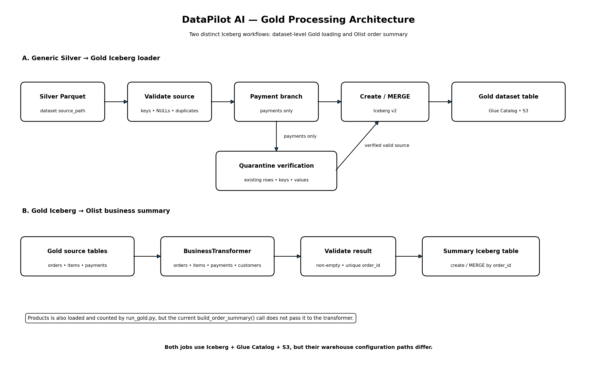

# DataPilot AI — Gold Processing with Apache Iceberg

**Document path:** `docs/pipeline/gold-processing.md`  
**Primary sources reviewed:** `spark/jobs/gold_incremental_iceberg.py` and `spark/jobs/run_gold.py`  
**Supporting transformation source:** `framework/business_transformer.py`  
**Purpose:** document both Gold workflows: the generic incremental Silver-to-Gold Iceberg loader (including payment quarantine safeguards) and the downstream Olist order business-summary builder.

## 1. Overview

DataPilot AI has two distinct Gold processing jobs. The generic `gold_incremental_iceberg.py` loader creates or incrementally updates configured Gold Iceberg tables from Silver datasets. The separate `run_gold.py` job reads selected Gold Iceberg tables and builds the Olist order business summary. Their implementation details are documented separately in Part I and Part II.

At a high level, it:

1. Loads and validates the Gold configuration.
2. Selects an enabled dataset and resolves its Silver source path, target table and business keys.
3. Starts Spark with an Apache Iceberg Glue Catalog and S3 FileIO.
4. Reads Silver Parquet and validates business keys and source duplicates.
5. Applies additional quarantine checks for `olist_order_payments`.
6. Adds Gold ingestion metadata.
7. Creates a new Iceberg table or incrementally MERGEs into an existing table.
8. Performs post-load validation and stops Spark.

## Gold processing flow


*The generic dataset loader and the Olist order-summary builder are separate Spark applications. The payment quarantine branch applies only to `olist_order_payments` in the generic loader.*

## 2. Runtime entry point and arguments

The script is:

```text
spark/jobs/gold_incremental_iceberg.py
```

It accepts two command-line arguments:

| Argument | Required | Default / meaning |
|---|---:|---|
| `--dataset` | Yes | Dataset key configured under `gold.tables` |
| `--config` | No | `/opt/datapilot/config/gold_tables.yaml` |

The script rejects a dataset that is not present in the configured table mapping or whose `enabled` flag is false.

## 3. Configuration-driven target resolution

The job reads YAML using `yaml.safe_load` and expects a mapping. It obtains these top-level Gold settings:

- `catalog`
- `database`
- `warehouse`
- `tables`

For the selected dataset it reads:

- `source_path`
- `target_table`
- `keys`
- `enabled`

The target identifier is constructed as:

```text
<catalog>.<database>.<target_table>
```

The job does not hard-code each dataset's source path or target table in its processing logic. Those values are supplied by `gold_tables.yaml`.

## 4. Spark and Iceberg catalog

`create_spark(catalog, warehouse)` configures Spark with:

- Iceberg `SparkCatalog`
- AWS Glue Catalog implementation
- Configured warehouse location
- Iceberg AWS `S3FileIO`

The script also configures S3 multipart upload settings, HTTP client timeouts/connections, S3 retry settings, shuffle partitions and default parallelism.

The key catalog implementation settings are:

```text
org.apache.iceberg.spark.SparkCatalog
org.apache.iceberg.aws.glue.GlueCatalog
org.apache.iceberg.aws.s3.S3FileIO
```

The database is created if it does not already exist:

```sql
CREATE DATABASE IF NOT EXISTS `<catalog>`.`<database>`
```

The script sets Spark's log level to `WARN`.

## 5. Silver source read and common validation

The source is read as Parquet:

```python
source_df = spark.read.parquet(source_path)
```

It is persisted using `StorageLevel.MEMORY_AND_DISK`, counted, and its schema is printed.

### 5.1 Business-key validation

`validate_keys()` checks:

1. Every configured business-key column exists in the source DataFrame.
2. No source row has a NULL value in any configured business-key column.

A missing key column or NULL key causes the job to raise `RuntimeError`.

### 5.2 Duplicate-key validation

`validate_source_duplicates()` groups by the configured business keys and checks whether any key group has more than one row. If duplicates exist, the job fails before writing Gold.

This is a source-side uniqueness guard. After the load, the script also validates that the Gold target contains no duplicate business-key groups.

## 6. Generic Gold table creation and incremental MERGE

After common validation and any dataset-specific filtering, the job adds two metadata columns:

| Column | Value |
|---|---|
| `gold_ingestion_timestamp` | Spark `current_timestamp()` |
| `gold_source_layer` | Literal value `silver` |

### 6.1 First load: create Iceberg table

If the target table does not exist, the job writes the DataFrame using:

```python
gold_df.writeTo(target) \
    .using("iceberg") \
    .tableProperty("format-version", "2") \
    .create()
```

This creates the target as an Iceberg format-version 2 table.

### 6.2 Subsequent load: MERGE

If the target already exists, the job:

1. Creates or replaces the temporary view `gold_incremental_source`.
2. Builds an equality condition from the configured business keys.
3. Executes an Iceberg `MERGE`.

The generated SQL pattern is:

```sql
MERGE INTO <catalog>.<database>.<target_table> AS target
USING gold_incremental_source AS source
ON target.<key_1> = source.<key_1>
   AND target.<key_2> = source.<key_2>
WHEN MATCHED THEN UPDATE SET *
WHEN NOT MATCHED THEN INSERT *
```

The actual key predicates are generated from the dataset's configured `keys`.

**Behavior:** a matching business key is updated from the source row; a new business key is inserted. The script does not define a separate delete branch in this MERGE statement.

## 7. Payment-specific quality and quarantine controls

The additional quarantine flow is activated only when:

```text
dataset == olist_order_payments
```

The script imports and uses:

```python
split_valid_and_invalid_payments(source_df)
```

from `framework.payment_quality`.

The payment source must contain all of these columns:

- `order_id`
- `payment_sequential`
- `payment_type`
- `payment_installments`
- `payment_value`

The shared payment-quality function separates valid and invalid payment records. In the existing DataPilot implementation, `payment_installments` is valid when it is non-NULL and between 1 and 100 inclusive.

### 7.1 Quarantine configuration validation

The job expects a sibling configuration file at:

```text
<gold-config-directory>/quarantine/olist_order_payments.yaml
```

It validates that the quarantine settings match the expected values:

| Setting | Required value |
|---|---|
| `enabled` | `true` |
| `catalog` | `glue_catalog` |
| `database` | `datapilot` |
| `table` | `olist_order_payments_quarantine` |
| `format` | `iceberg` |
| `source_layer` | `silver` |
| `target_layer` | `quarantine` |
| `keys` | Same configured payment business keys |
| `validate_source_duplicates` | `true` |

A missing or mismatched quarantine configuration blocks the Gold job.

### 7.2 When quarantine verification is required

The script checks both:

- Invalid payment records currently present in Silver.
- Invalid payment records already present in an existing Gold payments table.

If either count is greater than zero, the quarantine Iceberg table must exist. The script also requires the quarantine table to contain these metadata columns:

- `execution_id`
- `quarantine_reason`
- `rule_name`
- `source_layer`
- `quarantined_at`

### 7.3 Record-level verification

`verify_records_are_quarantined()` validates the quarantine evidence before allowing the Gold changes:

1. The quarantine table must contain all required payment source columns.
2. Source and quarantine data types for those columns must match.
3. Quarantine business keys must not contain NULL values.
4. Quarantine business keys must be unique.
5. Each input record must have a matching quarantine record on the configured business keys.
6. Every source payment field is compared using null-safe equality.

The function is used for invalid Silver records and, when present, invalid records already in Gold.

If a record is missing from quarantine or any source field differs, the job raises an error and blocks Gold changes.

### 7.4 Valid payment records only

For the payment dataset, the job sets the Gold source to the valid payment DataFrame:

```python
gold_source = valid_source
```

Invalid Silver payment rows are therefore excluded from the incoming Gold DataFrame.

If an existing Gold payments table contains invalid rows, the script deletes those rows only after the corresponding records have been verified in quarantine:

```sql
DELETE FROM <gold_payment_table>
WHERE payment_installments IS NULL
   OR payment_installments < 1
   OR payment_installments > 100
```

This delete is conditional on the target already existing and the previously detected invalid Gold count being greater than zero.

**Important boundary:** this Gold loader verifies that invalid payment records are already represented in the quarantine table. It does not create or populate the quarantine records itself. Quarantine creation/execution belongs to the separate remediation workflow.

## 8. Post-load validation

After table creation or MERGE, the script reads the target table and counts its records.

### 8.1 Gold business-key uniqueness

It groups the Gold table by the configured business keys and counts duplicate key groups. Any duplicate group causes the job to fail.

### 8.2 Payment-specific validation

For `olist_order_payments`, it calls `count_invalid_payments()` against the Gold target. If any invalid payment records remain, the job fails.

On success, it prints the dataset, target table, record count and `DQ: PASS`.

## 9. Resource cleanup

The job uses a `finally` block to:

- Unpersist the Silver source DataFrame, if initialized.
- Unpersist invalid payment records, if initialized.
- Unpersist the quarantine DataFrame, if initialized.
- Unpersist existing invalid Gold payment records, if initialized.
- Stop the Spark session.

This cleanup is attempted whether the load succeeds or raises an exception.

## 10. Dataset behavior summary

| Capability | All configured datasets | `olist_order_payments` only |
|---|:---:|:---:|
| Read Silver Parquet | Yes | Yes |
| Validate configured key columns | Yes | Yes |
| Reject NULL business keys | Yes | Yes |
| Reject duplicate source keys | Yes | Yes |
| Add Gold ingestion metadata | Yes | Yes |
| Create Iceberg v2 table on first load | Yes | Yes |
| Incremental MERGE on later loads | Yes | Yes |
| Validate Gold duplicate keys | Yes | Yes |
| Split valid and invalid payments | No | Yes |
| Validate quarantine configuration | No | Yes |
| Verify records in quarantine | No | Yes, when invalid records exist |
| Remove previously invalid Gold payment rows after quarantine verification | No | Yes |
| Validate no invalid payment rows remain | No | Yes |

## 11. Operational boundaries and considerations

1. **Configuration is authoritative:** source paths, target tables and business keys come from the selected Gold configuration.
2. **No source-key deduplication:** duplicate source business keys cause a failure; the script does not silently choose a winner.
3. **MERGE key correctness matters:** the configured business keys determine row matching and therefore update/insert behavior.
4. **Payment quarantine is a gate:** invalid payment records must be present and value-matched in the quarantine table before the job can proceed with the relevant Gold changes.
5. **Quarantine is not written here:** this job reads and verifies quarantine evidence; it does not execute the remediation workflow.
6. **Post-load checks occur after the write:** a validation failure after table creation/MERGE indicates that a write may already have happened. Investigate the Iceberg table and Spark logs before deciding on a retry.
7. **The script uses dynamic SQL identifiers:** catalog, database, target table and generated key expressions originate from configuration. Treat configuration as trusted deployment input and validate changes through code review.
8. **No separate delete branch in the generic MERGE:** the shown MERGE updates matched rows and inserts unmatched rows. The payment-specific DELETE is a distinct, guarded operation.
9. **Separate summary workflow:** the Olist business-summary job (`spark/jobs/run_gold.py`) is documented in Part II; it is a distinct Spark application with its own configuration and validation behavior.

## 12. Related components

| Component | Responsibility |
|---|---|
| `config/gold_tables.yaml` | Dataset-to-source/target/key configuration for the incremental Gold loader |
| `config/quarantine/olist_order_payments.yaml` | Payment quarantine table and validation settings |
| `framework/payment_quality.py` | Shared valid/invalid payment split |
| `spark/jobs/gold_incremental_iceberg.py` | Generic Silver-to-Gold Iceberg create/MERGE job |
| `spark/jobs/run_gold.py` | Separate Olist business-summary Gold job |
| `agents/remediation/` and remediation Spark jobs | Approval-controlled quarantine/remediation workflow |

---

**Part I maintenance note:** Update this section when the generic Gold configuration contract, business-key validation, Iceberg catalog settings, MERGE semantics, payment quality rule, quarantine verification, or post-load checks change. Keep the generic Gold path distinct from the payment-specific safeguards and the separate business-summary job.

# Part II — Olist Order Business Summary

**Primary source reviewed:** `spark/jobs/run_gold.py`  
**Transformation component:** `framework/business_transformer.py`  
**Configuration files:** `config/variables.yaml` and `config/gold/olist_order_summary.yaml`

## 13. Purpose and position in the pipeline

`run_gold.py` builds the Olist order business summary from existing Gold Iceberg tables. It is a separate workflow from the generic dataset-by-dataset loader documented in Part I.

The Airflow DAG invokes this job as `gold_olist_order_summary` after all nine individual Gold dataset tasks have completed successfully under the operator's default trigger behavior.

The summary job:

1. Loads global storage variables and the selected summary-table YAML.
2. Configures an Iceberg Glue Catalog.
3. Reads five configured Gold Iceberg source tables.
4. Validates source duplicate keys.
5. Calls `BusinessTransformer.build_order_summary()` with four DataFrames.
6. Validates the transformed result.
7. Adds Gold metadata.
8. Creates or incrementally MERGEs the summary Iceberg table.
9. Confirms the final table is non-empty.

## 14. Runtime arguments and configuration

The script is:

```text
spark/jobs/run_gold.py
```

It accepts:

| Argument | Required | Default / allowed value |
|---|---:|---|
| `--table` | Yes | Currently restricted to `olist_order_summary` |
| `--config-root` | No | `/opt/datapilot/config` |

It loads:

```text
<config-root>/variables.yaml
<config-root>/gold/<table>.yaml
```

The variables file supplies the S3 bucket and configured Gold layer path. `build_iceberg_warehouse()` constructs:

```text
s3a://<storage.bucket>/<storage.layers.gold>
```

The selected Gold YAML supplies `source.tables` and `target.table`.

### Catalog and database

The script defines these constants in code:

```text
ICEBERG_CATALOG = glue_catalog
ICEBERG_DATABASE = datapilot
```

The target table name is built as:

```text
glue_catalog.datapilot.<target.table>
```

Unlike the generic loader in Part I, this business-summary script hard-codes its catalog and database constants and builds its warehouse from `variables.yaml`.

## 15. Iceberg configuration

`configure_iceberg()` configures:

- Iceberg Spark Catalog
- AWS Glue Catalog implementation
- Warehouse location from `variables.yaml`
- Iceberg AWS S3FileIO
- S3A AWS profile credentials provider
- S3 endpoint region `us-east-1`

The script creates the Glue database if it does not already exist.

## 16. Source tables

The summary configuration identifies five source table roles:

| Source role | Table read by the job |
|---|---|
| Orders | `source.tables.orders` |
| Order items | `source.tables.order_items` |
| Payments | `source.tables.payments` |
| Customers | `source.tables.customers` |
| Products | `source.tables.products` |

Each table is read through `spark.table()` using the `glue_catalog.datapilot` namespace.

The script prints a row count for all five DataFrames.

**Important implementation detail:** the script loads the Products table and reports its count, but the current `BusinessTransformer.build_order_summary()` call receives only `orders`, `order_items`, `payments`, and `customers`. Products is not passed into this transformation method in the reviewed source. Do not describe the current summary calculation as joining Products unless the transformer implementation is changed and verified.

## 17. Source duplicate validation

Before transformation, the script checks for duplicate groups using these keys:

| Source | Duplicate-validation key |
|---|---|
| Orders | `order_id` |
| Order items | `order_id`, `order_item_id` |
| Payments | `order_id`, `payment_sequential` |
| Customers | `customer_id` |
| Products | `product_id` |

Any duplicate key group causes a `RuntimeError`.

The reviewed script does not show explicit NULL-key validation for these source tables. Its source validation here is specifically duplicate-group detection.

## 18. Business transformation

The script creates:

```python
transformer = BusinessTransformer(spark)
```

It calls:

```python
result = transformer.build_order_summary(
    orders=orders,
    order_items=order_items,
    payments=payments,
    customers=customers,
)
```

The detailed join strategy, aggregation order, output columns, and business calculations are implemented in `framework/business_transformer.py`, not in `run_gold.py`.

This document therefore describes the invocation and its input contract only. The exact summary schema and calculation rules should be documented from the transformer source rather than inferred from the runner.

## 19. Summary result validation and metadata

`validate_result()` checks:

1. The transformed result contains at least one row.
2. There are no duplicate groups for the summary key `order_id`.

If either check fails, the job raises a `RuntimeError`.

The script then adds:

| Column | Value |
|---|---|
| `gold_ingestion_timestamp` | Spark `current_timestamp()` |
| `gold_source_layer` | Literal value `gold` |

It prints the resulting schema, source count, and extended Spark execution plan.

## 20. Summary Iceberg create and MERGE

The target table is resolved from the `target.table` entry in the summary YAML and the fixed catalog/database constants.

### First run: create

If the target is considered absent, `create_iceberg_table()` writes the result using Iceberg format version 2:

```python
result.writeTo(table_name) \
    .using("iceberg") \
    .tableProperty("format-version", "2") \
    .create()
```

### Later runs: incremental MERGE

If the target is considered present, `merge_iceberg_table()`:

1. Calls `localCheckpoint(eager=True)` to materialize the transformed source and break up the upstream join lineage.
2. Counts the materialized rows.
3. Registers a temporary view named `gold_summary_source`.
4. Builds the MERGE condition using the summary key `order_id`.
5. Executes an Iceberg MERGE:
   - Matched `order_id`: `UPDATE SET *`
   - Unmatched `order_id`: `INSERT *`
6. Drops the temporary view and unpersists the checkpointed DataFrame in a `finally` block.

There is no delete clause in the summary MERGE.

### Table-existence behavior

The script's `table_exists()` helper attempts `spark.table(table_name)` and returns `False` for any caught exception. This means an exception other than a genuine missing-table condition could also be interpreted as absence, potentially leading the script down the create path. This is an implementation consideration for operational troubleshooting.

## 21. Final summary validation

After create or MERGE, the script reads the target Iceberg table and checks that its total row count is not zero.

The reviewed code does not perform a second post-MERGE duplicate-key validation on the final target; the duplicate check is performed on the transformed source before writing.

On success, the job prints the target table, record count, storage format, source layer and incremental mode.

The Spark session is stopped in a `finally` block.

## 22. Comparison of the two Gold jobs

| Area | Generic incremental loader | Olist business-summary job |
|---|---|---|
| Script | `gold_incremental_iceberg.py` | `run_gold.py` |
| Scope | One configured Silver dataset per invocation | One configured summary table |
| Main source | Silver Parquet | Existing Gold Iceberg tables |
| Config | `gold_tables.yaml` | `variables.yaml` + `gold/olist_order_summary.yaml` |
| Catalog/database | From Gold config | Hard-coded `glue_catalog.datapilot` |
| Business keys | Per-dataset configured keys | `order_id` for summary |
| Transformation | Dataset-specific input is loaded; payment dataset has additional filtering | `BusinessTransformer.build_order_summary()` |
| Quarantine logic | Payment-only verification and guarded cleanup | No quarantine branch shown |
| First load | Create Iceberg v2 table | Create Iceberg v2 table |
| Later load | MERGE matched/update and unmatched/insert | MERGE matched/update and unmatched/insert |
| Final validation | Duplicate Gold keys; payment validity for payments | Final table non-empty |
| Metadata source layer | `silver` | `gold` |

## 23. Configuration and warehouse distinction

The two Gold jobs obtain their warehouse configuration differently:

- `gold_incremental_iceberg.py` reads `catalog`, `database`, and `warehouse` from the `gold` section of `gold_tables.yaml`.
- `run_gold.py` builds the warehouse from `storage.bucket` and `storage.layers.gold` in `variables.yaml`, while catalog and database are constants in the script.

These are distinct configuration paths in the reviewed code. Confirm the actual YAML values and deployed runtime paths before assuming both jobs write metadata or data files under an identical warehouse location. This document intentionally does not reconcile the two configurations.

## 24. Operational boundaries

1. The summary job is downstream of the individual Gold dataset tasks in the Airflow DAG.
2. It reads Gold Iceberg tables; it does not read Silver Parquet directly.
3. The Products table is loaded but is not passed to the current summary transformation call.
4. Source duplicate validation is explicit, but the reviewed runner does not explicitly reject NULL source keys.
5. The summary result is checked for non-empty output and unique `order_id` before writing.
6. The final target is checked for non-zero rows after writing; no final duplicate-key scan is shown.
7. The summary job does not perform remediation approval, quarantine writes, or source correction.
8. The exact business calculations and output schema require review of `framework/business_transformer.py` and the summary YAML.
9. The generic and summary jobs have different warehouse-configuration mechanisms; keep this distinction visible when troubleshooting storage/catalog behavior.

## 25. Related components

| Component | Responsibility |
|---|---|
| `spark/jobs/gold_incremental_iceberg.py` | Generic Silver-to-Gold dataset loader |
| `spark/jobs/run_gold.py` | Olist business-summary runner |
| `framework/business_transformer.py` | Summary transformation implementation |
| `config/gold_tables.yaml` | Generic Gold dataset/source/target/key configuration |
| `config/gold/olist_order_summary.yaml` | Summary source and target configuration |
| `config/variables.yaml` | Storage bucket and layer paths |
| `dags/datapilot_olist_pipeline.py` | Airflow orchestration and Gold-summary dependency |

---

**Maintenance note:** Update Part II when the summary's source tables, transformation inputs, business logic, output schema, merge keys, or warehouse configuration changes. Review the runner, transformer and YAML together so the documentation reflects the complete implementation.
