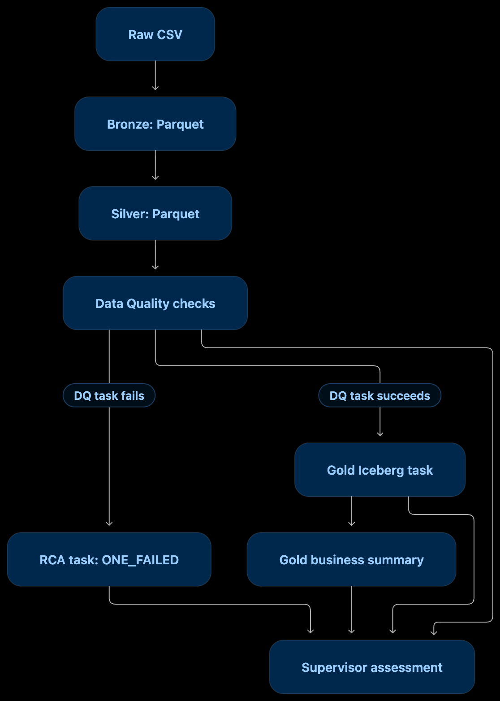

# DataPilot AI — Airflow Pipeline Orchestration

**Document path:** `docs/pipeline/pipeline-orchestration.md`  
**Source reviewed:** `dags/datapilot_olist_pipeline.py`  
**DAG ID:** `datapilot_olist_order_pipeline`

## 1. Purpose

The `datapilot_olist_order_pipeline` DAG orchestrates the Olist data-processing workflow across Bronze, Silver, data-quality (DQ), root-cause analysis (RCA), Gold, Gold business-summary, and final Supervisor-assessment stages.

Airflow coordinates the execution of Spark applications and Python callables. The DAG defines task groups programmatically from dataset lists and connects corresponding datasets through dependency edges.

The pipeline is manually triggered: `schedule=None` and `catchup=False`.

## 2. High-level flow




**Important dependency detail:** the code connects each DQ task to both its corresponding Gold task and its corresponding RCA task. The RCA task uses `TriggerRule.ONE_FAILED`. A DQ task that succeeds therefore does not normally trigger RCA; a failed DQ task can trigger it. Gold tasks use the operator's default trigger rule, so a failed upstream DQ task prevents that dataset's Gold task from running under the usual `all_success` behavior.

The Supervisor task is configured with `TriggerRule.ALL_DONE` and is downstream of all DQ, RCA, Gold, and Gold-summary tasks. This makes it the final assessment point after those execution paths finish, including failed or skipped upstream tasks.

## 3. DAG configuration

The DAG is declared with these settings:

| Setting | Value |
|---|---|
| DAG ID | `datapilot_olist_order_pipeline` |
| Start date | `2026-01-01` |
| Schedule | `None` (manual trigger) |
| Catchup | `False` |
| Maximum active tasks | `1` |
| Maximum active runs | `1` |
| Spark connection | `spark_default` |

The single-active-task and single-active-run limits serialize execution at the DAG level. They also reduce the chance of concurrent runs reading or writing the same dataset-scoped DQ result files.

Tags include `datapilot`, `olist`, `spark`, `bronze`, `silver`, `dq`, and `gold`.

## 4. Dataset coverage

The DAG declares nine datasets for each of Bronze, Silver, and DQ:

1. `olist_customers`
2. `olist_orders`
3. `olist_order_items`
4. `olist_order_payments`
5. `olist_order_reviews`
6. `olist_products`
7. `olist_sellers`
8. `olist_geolocation`
9. `olist_product_category_translation`

The Gold dataset list contains the same nine datasets, in a different order:

1. `olist_customers`
2. `olist_geolocation`
3. `olist_order_items`
4. `olist_order_payments`
5. `olist_order_reviews`
6. `olist_orders`
7. `olist_product_category_translation`
8. `olist_products`
9. `olist_sellers`

The lists are declared separately in the DAG source. Keeping them aligned is therefore a configuration-maintenance responsibility; the code shown does not derive all four lists from one shared registry.

## 5. Stage-by-stage orchestration

### 5.1 Bronze

**Purpose:** convert each raw CSV dataset into Bronze Parquet.

For every entry in `BRONZE_TABLES`, Airflow creates a `SparkSubmitOperator` task named:

```text
bronze_<dataset>
```

It submits:

```text
/opt/spark-apps/jobs/run_pipeline.py
```

with the arguments:

```text
--layer bronze
--table <dataset>
--config-root /opt/datapilot/config
```

The Spark framework archive is supplied through `py_files`:

```text
/opt/spark-apps/framework.zip
```

### 5.2 Silver

**Purpose:** process each Bronze dataset into Silver Parquet.

For every entry in `SILVER_TABLES`, Airflow creates:

```text
silver_<dataset>
```

It submits the same `run_pipeline.py` application with:

```text
--layer silver
--table <dataset>
--config-root /opt/datapilot/config
```

Each Bronze task is directly upstream of its matching Silver task:

```text
bronze_<dataset> >> silver_<dataset>
```

This is a per-dataset dependency; the DAG does not require all Bronze datasets to finish before any Silver dataset can begin.

### 5.3 Data Quality

**Purpose:** execute configured DQ checks against each Silver dataset.

For every entry in `DQ_TABLES`, Airflow creates:

```text
dq_<dataset>
```

It submits:

```text
/opt/spark-apps/jobs/run_dq.py
```

with:

```text
--table <dataset>
--config-root /opt/datapilot/config
```

Each Silver task is directly upstream of its matching DQ task:

```text
silver_<dataset> >> dq_<dataset>
```

The DQ application is responsible for reading the Silver data, executing the configured checks, and writing its result. The DAG itself does not define individual DQ rules.

### 5.4 RCA

**Purpose:** run the RCA agent for a dataset when its DQ task fails.

For each DQ dataset, the DAG creates a Python task:

```text
rca_<dataset>
```

The callable is `run_rca`, and the dataset is passed as the `table` keyword argument. Its trigger rule is:

```python
TriggerRule.ONE_FAILED
```

The corresponding DQ task is upstream of both RCA and Gold:

```text
dq_<dataset> >> rca_<dataset>
dq_<dataset> >> gold_<dataset>
```

#### RCA execution sequence

The `run_rca(table)` callable performs these steps:

1. Reads the current Airflow DAG run and obtains its `run_id`.
2. Calls the MCP tool `get_dq_result` with the dataset name.
3. Requires the returned DQ status to be `FAIL`; otherwise it raises a `ValueError`.
4. Calls `extract_failed_range_check()` to identify the failed range check.
5. Requires exactly one failed check whose name starts with `range_check:`.
6. Parses a range expression in the form `minimum <= value <= maximum`.
7. Extracts the column name and numeric minimum/maximum bounds.
8. Creates a run-specific RCA output directory:
   ```text
   /opt/datapilot/results/rca/<run_id>/
   ```
9. Builds the RCA output path:
   ```text
   /opt/datapilot/results/rca/<run_id>/<dataset>.json
   ```
10. Runs the RCA agent as a subprocess, passing the dataset, column, minimum, maximum, and output path.
11. Captures and prints standard output. If the process exits non-zero, it prints standard error and raises a `RuntimeError`.
12. Verifies that the expected output file exists; otherwise it raises a `RuntimeError`.

The RCA agent script path is:

```text
/opt/datapilot/agents/rca/rca_agent.py
```

The subprocess runs with `/opt/datapilot` as its working directory. The callable sets `MCP_SERVER_URL` to `http://mcp-server:8000/mcp` and adds `/opt/datapilot` to `PYTHONPATH`.

#### Range-check extraction constraints

`extract_failed_range_check()` is intentionally narrow:

- It filters DQ checks to entries with `status == "FAIL"` and a check name beginning with `range_check:`.
- It raises an error if no failed range check is found.
- It raises an error if more than one failed range check is found.
- It requires a `range` expression.
- It accepts signed integer or decimal bounds in the expression `minimum <= value <= maximum`.
- Integer-valued bounds are converted to integers; other bounds remain floats.

Consequently, this DAG's RCA task does not dynamically handle arbitrary DQ failure types or multiple failed range checks. Those cases fail the RCA task rather than being silently interpreted.

### 5.5 Gold Iceberg datasets

**Purpose:** process each dataset from Silver into its corresponding Gold Iceberg table.

For every entry in `GOLD_TABLES`, Airflow creates:

```text
gold_<dataset>
```

It submits:

```text
/opt/spark-apps/jobs/gold_incremental_iceberg.py
```

with:

```text
--dataset <dataset>
--config /opt/datapilot/config/gold_tables.yaml
```

The DAG connects each DQ task directly to its corresponding Gold task. There is no separate explicit Silver-to-Gold edge in the DAG; the path is mediated by the DQ task.

The detailed Iceberg table creation, merge behavior, key validation, and dataset-specific transformation logic belong to the Gold Spark application and its configuration, not to this orchestration file.

### 5.6 Gold business summary

**Purpose:** build the Olist order business summary after the individual Gold dataset tasks.

The DAG creates one task:

```text
gold_olist_order_summary
```

It submits:

```text
/opt/spark-apps/jobs/run_gold.py
```

with:

```text
--table olist_order_summary
--config-root /opt/datapilot/config
```

All nine Gold dataset tasks are upstream of this summary task:

```text
gold_<dataset> >> gold_olist_order_summary
```

Therefore, the business summary waits for the full set of Gold tasks according to the operators' trigger behavior.

### 5.7 Final Supervisor assessment

**Purpose:** perform a final assessment of the DAG run after the processing and diagnostic paths have completed.

The task is named:

```text
supervisor_assessment
```

It uses the Python callable `run_supervisor_assessment` and has:

```python
TriggerRule.ALL_DONE
```

The callable obtains the current Airflow context and DAG run, then calls:

```python
run_dag_assessment(
    dag_run=dag_run,
    dq_tables=DQ_TABLES,
    gold_tables=GOLD_TABLES,
)
```

It prints the resulting Supervisor decision.

The Supervisor task is downstream of:

- Every DQ task
- Every RCA task
- Every Gold dataset task
- The Gold business-summary task

The DAG therefore schedules the final assessment after those upstream tasks have reached terminal states, rather than requiring every upstream task to succeed.

The DAG callable delegates the assessment to `run_dag_assessment`; this orchestration code does not itself invoke the RCA agent from the Supervisor task.

## 6. Dependency reference

The core dependency declarations are:

```python
# Bronze -> Silver
for table in BRONZE_TABLES:
    bronze_tasks[table] >> silver_tasks[table]

# Silver -> DQ
for table in SILVER_TABLES:
    silver_tasks[table] >> dq_tasks[table]

# DQ -> Gold and RCA
for table in DQ_TABLES:
    dq_tasks[table] >> gold_tasks[table]
    dq_tasks[table] >> rca_tasks[table]

# All Gold datasets -> business summary
for table in GOLD_TABLES:
    gold_tasks[table] >> gold_olist_order_summary

# DQ, RCA, Gold and summary -> Supervisor
for table in DQ_TABLES:
    dq_tasks[table] >> supervisor_assessment
    rca_tasks[table] >> supervisor_assessment

for table in GOLD_TABLES:
    gold_tasks[table] >> supervisor_assessment

gold_olist_order_summary >> supervisor_assessment
```

### Per-dataset path

```text
bronze_<dataset>
    |
    v
silver_<dataset>
    |
    v
dq_<dataset>
    |----------------------|
    v                      v
gold_<dataset>         rca_<dataset>
    |                      |
    +----------+-----------+
               |
               v
      supervisor_assessment
```

The full DAG also has a fan-in from all nine Gold tasks into `gold_olist_order_summary`, which itself feeds the Supervisor.

## 7. Spark runtime configuration

The DAG uses:

```text
SPARK_CONNECTION = spark_default
```

Spark configuration includes the S3A AWS credentials provider:

```text
software.amazon.awssdk.auth.credentials.ProfileCredentialsProvider
```

The Spark environment specifies:

```text
AWS_PROFILE=datapilot
AWS_DEFAULT_REGION=us-east-1
AWS_SHARED_CREDENTIALS_FILE=/opt/spark/.aws/credentials
AWS_CONFIG_FILE=/opt/spark/.aws/config
```

The Spark configuration also sets the S3A endpoint region to `us-east-1`.

These are runtime configuration values referenced by the DAG. Actual credential availability depends on the mounted/configured AWS profile in the runtime environment. Do not place credential values in this documentation.

## 8. Application and configuration path reference

| Purpose | Runtime path |
|---|---|
| Generic Bronze/Silver pipeline | `/opt/spark-apps/jobs/run_pipeline.py` |
| DQ application | `/opt/spark-apps/jobs/run_dq.py` |
| Incremental Gold Iceberg application | `/opt/spark-apps/jobs/gold_incremental_iceberg.py` |
| Gold dataset configuration | `/opt/datapilot/config/gold_tables.yaml` |
| Gold business-summary application | `/opt/spark-apps/jobs/run_gold.py` |
| RCA agent | `/opt/datapilot/agents/rca/rca_agent.py` |
| Spark framework archive | `/opt/spark-apps/framework.zip` |
| General configuration root | `/opt/datapilot/config` |
| Run-specific RCA output root | `/opt/datapilot/results/rca` |

These are container/runtime paths, not necessarily paths on the developer's Mac host.

## 9. Failure and trigger-rule behavior

| Situation | Behavior defined by this DAG |
|---|---|
| Bronze task fails | Its corresponding Silver task is not eligible to run under the default `all_success` behavior; downstream processing for that dataset is consequently blocked. |
| Silver task fails | Its corresponding DQ task is blocked under the default `all_success` behavior. |
| DQ task succeeds | Its corresponding RCA task does not meet `ONE_FAILED`; Gold can proceed. |
| DQ task fails | Its corresponding RCA task can run under `ONE_FAILED`; the corresponding Gold task is blocked under the default trigger rule. |
| RCA subprocess exits non-zero | `run_rca` raises `RuntimeError`, causing the RCA task to fail. |
| RCA output file is missing | `run_rca` raises `RuntimeError`. |
| One or more upstream tasks fail or are skipped | Supervisor is configured with `ALL_DONE`, so it can run after all its upstream tasks finish. |
| A Gold dataset task fails | The business-summary task normally cannot run under its default trigger rule because it requires all Gold upstream tasks to succeed. |

The final Supervisor assessment is an assessment step, not a mechanism that changes upstream task states or automatically repairs failed tasks.

## 10. Operational boundaries and observations

1. **Manual execution:** the DAG has no schedule. An operator or authorized workflow must trigger it.
2. **Serialized DAG execution:** `max_active_tasks=1` and `max_active_runs=1` limit concurrency for this DAG.
3. **Dataset-level DQ result lookup:** RCA retrieves DQ results through `get_dq_result(dataset)` without passing the Airflow run ID. The RCA output path is run-specific, but the DQ lookup shown in this DAG is dataset-scoped. The runtime's DQ result freshness and overwrite behavior should be considered when diagnosing historical runs.
4. **RCA scope:** the orchestration code supports one failed numeric range check per dataset for this RCA invocation. It raises an error for zero or multiple failed range checks.
5. **Gold dependency:** Gold is downstream of DQ in the dependency graph. This means a DQ task failure blocks that dataset's Gold task under the default trigger rule; RCA is a separate diagnostic branch.
6. **Supervisor scope:** the Supervisor is downstream of the DQ, RCA, Gold, and summary tasks and uses `ALL_DONE`. Its assessment is not an approval to perform remediation writes.
7. **Remediation is separate:** this DAG does not define remediation approval or remediation execution tasks. Those workflows are implemented in separate remediation and approval DAGs and supporting components.
8. **No implicit global stage barrier:** Bronze, Silver, DQ, RCA, and Gold tasks are connected by per-dataset dependencies. The DAG does not add a global barrier requiring all datasets in one stage to finish before any dataset in the next stage starts.
9. **Configuration lists:** Bronze, Silver, DQ, and Gold dataset lists are separately declared. Changes to dataset coverage should be reviewed across all lists and related configuration files.

## 11. What this DAG does not implement

This orchestration file does not itself:

- Define the detailed Bronze or Silver transformations.
- Define the individual DQ rules.
- Implement Iceberg MERGE logic or Gold table schemas.
- Implement the RCA reasoning logic; it invokes the RCA agent script.
- Approve or execute remediation.
- Implement the Supervisor's assessment logic; it calls `run_dag_assessment`.
- Provide a recurring schedule.

Those responsibilities belong to the corresponding Spark jobs, configuration files, agents, MCP tools, and separate remediation workflows.

## 12. Related documentation

- `docs/architecture/architecture.md`
- `docs/pipeline/spark-framework.md`
- `docs/pipeline/data-quality.md`
- `docs/agents/rca-agent.md`
- `docs/agents/supervisor-agent.md`
- `docs/operations/mcp-tools.md`
- `docs/operations/remediation-workflow.md`

---

**Maintenance note:** Update this document when the DAG's task lists, task IDs, operators, trigger rules, runtime paths, Spark configuration, or dependency edges change. Keep descriptions aligned with the actual DAG source rather than assuming that all stages execute as a global sequence.
