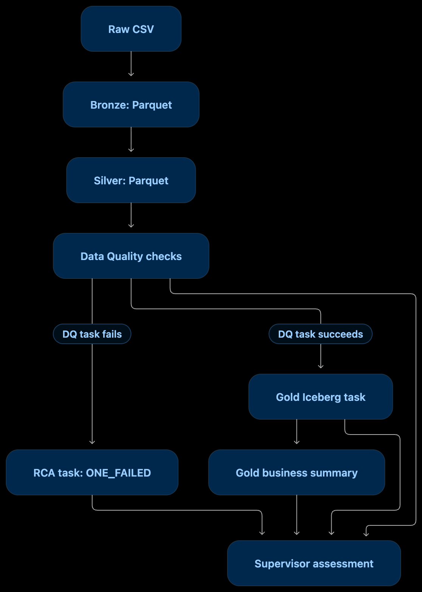
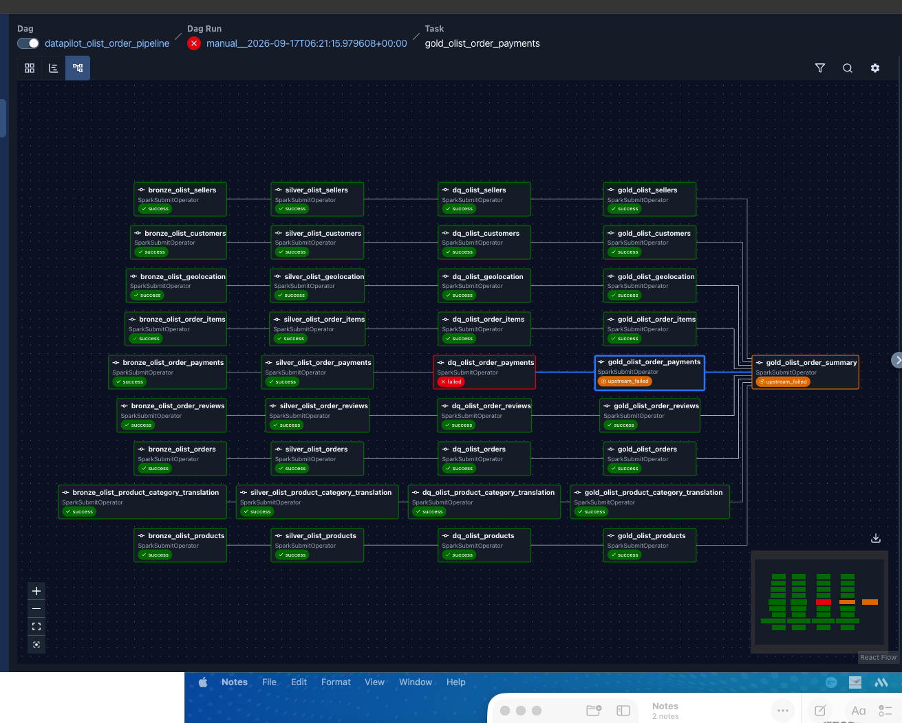
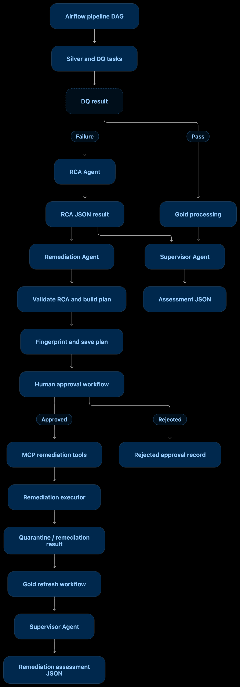
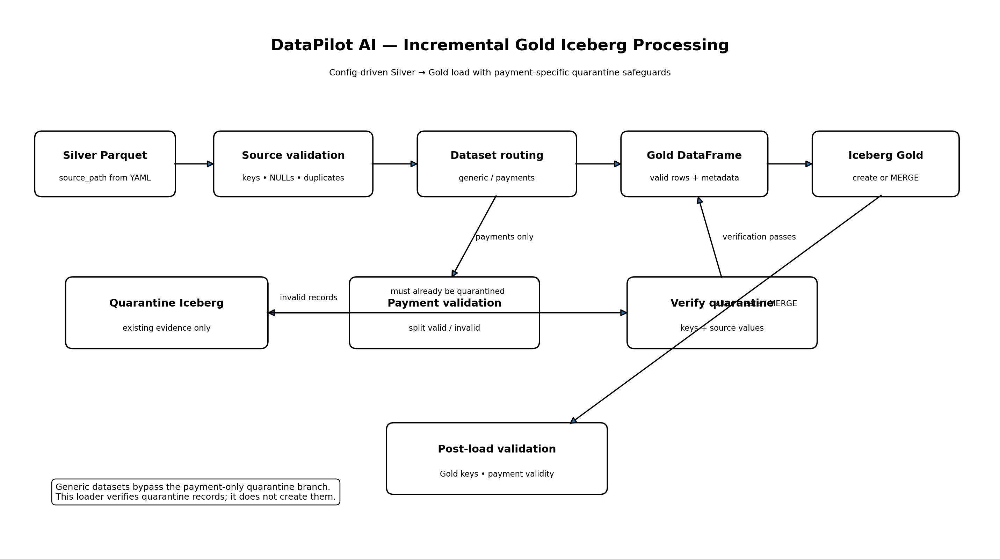
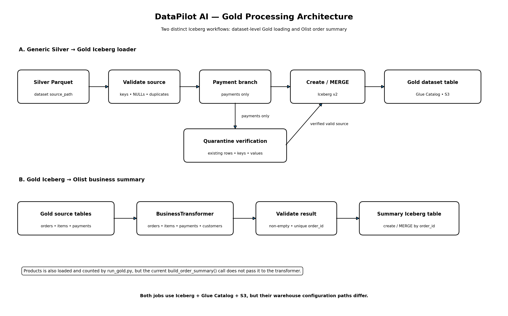

# DataPilot AI

**An AI-assisted data engineering and DataOps platform for reliable data pipelines, governed remediation, and operational intelligence.**

DataPilot AI demonstrates how a modern data platform can combine configuration-driven data engineering with AI agents and a retrieval-augmented Copilot. It is built around a practical e-commerce data scenario using the Olist dataset and is designed to show how teams can move from detecting a data problem to understanding it, planning a controlled response, and communicating the outcome.

> **Project positioning:** DataPilot AI is a locally runnable portfolio implementation. Its architecture includes AWS-oriented storage and catalog integrations, but cloud deployment is not claimed as completed. The Gold layer is configured to use **Apache Iceberg** tables; it should not be described as a Parquet Gold-table implementation.

## 1. Business problem

Data engineering teams are responsible for keeping data pipelines dependable and making trusted data available to analytics and downstream consumers. In a typical multi-stage pipeline, a failure or data-quality issue can create several operational problems:

- **Late detection:** invalid, incomplete, or inconsistent records may be discovered only after a pipeline stage fails or downstream data is questioned.

- **Slow investigation:** engineers often need to correlate DQ results, pipeline task states, dataset configuration, and historical operational information across different tools.

- **Manual root-cause analysis:** diagnosing why a dataset failed and deciding what to do next can require repeated investigation by experienced engineers.

- **Risky remediation:** directly changing or deleting bad records can damage trusted data if the action, scope, or approval is unclear.

- **Limited operational visibility:** pipeline status alone does not explain the business or data-quality impact, the likely cause, or the next recommended action.

- **Scattered engineering knowledge:** runbooks, architecture notes, and troubleshooting guidance are not always available in the context of an operational question.

The business case is to reduce the effort and risk involved in operating data pipelines by connecting data processing, data-quality checks, investigation, controlled remediation, operational assessment, and engineering knowledge in one demonstrable workflow.

DataPilot AI is a technical portfolio implementation of that approach. It does not claim measured production savings, reduced incident resolution time, or a quantified business ROI; those would require a production baseline and operational measurements.

## 2. How DataPilot AI addresses the problem

DataPilot AI combines a reusable data pipeline with specialized agents and a RAG-powered Copilot. Each component has a defined responsibility rather than allowing one autonomous agent to make unrestricted changes.

| Operational challenge | DataPilot AI capability | How it helps |

| Repeated pipeline implementation | Configuration-driven PySpark framework | Reuses common readers, transformations, path construction, writers, and DQ execution across datasets. |

| Pipeline coordination | Apache Airflow | Orchestrates Bronze, Silver, DQ, RCA, Gold, and Supervisor workflow stages. |

| Data-quality failures | Configurable data-quality framework | Applies dataset rules and produces evidence that can drive investigation. |

| Time-consuming investigation | RCA Agent | Analyzes failure evidence and produces a structured root-cause result with recommendations. |

| Unsafe or ambiguous data fixes | Remediation Agent and approval workflow | Creates a fingerprinted remediation plan and keeps human approval separate from execution. |

| Operational status without explanation | Supervisor Agent | Assesses pipeline and remediation outcomes and produces a structured operational assessment. |

| Searching technical documentation manually | RAG-powered Data Engineering Copilot | Retrieves relevant engineering knowledge from the indexed documentation and uses an LLM to formulate a response through an API. |

| Tool access across workflows | MCP server | Exposes defined inspection, approval, audit, and remediation operations to supported clients and agents. |

## 3. End-to-end solution flow

The platform demonstrates the following operational lifecycle:

1. **Ingest and process data.** Raw Olist datasets move through the Bronze and Silver processing stages using reusable PySpark components and centralized YAML configuration.

2. **Validate data quality.** Configured DQ rules evaluate processed datasets and record validation outcomes.

3. **Investigate failures.** When the relevant DQ failure path is reached, the RCA Agent uses the available evidence to produce a structured diagnosis.

4. **Prepare a remediation plan.** The Remediation Agent validates the RCA result and creates a remediation plan with a fingerprint and a pending-approval state.

5. **Apply governance controls.** The approval workflow records a human decision. The executor applies its own scope, approval, fingerprint, and execution-mode checks. A plan marked pending approval is not itself permission to write data.

6. **Assess operational outcomes.** The Supervisor Agent evaluates pipeline and remediation outcomes and produces a structured assessment. It does not replace the human approval boundary.

7. **Ask operational questions.** The Copilot retrieves relevant content from the knowledge base using Pinecone and generates an answer through the LLM integration, exposed by FastAPI.

The workflow is coordinated across Airflow, Python agents, the MCP server, the remediation executor, and the Copilot service. The components have separate responsibilities and explicit interfaces.

## 4. Architecture at a glance

The diagrams below use the project's existing visual assets so readers can understand the platform without needing to render Mermaid. All image paths are relative to the repository root and will render on GitHub when the \`images/\` directory is included. Keep the image filenames and folder structure unchanged when pushing the README.

**Architecture:** See [DataPilot AI Architecture](docs/architecture/architecture.md) for the detailed component design, data flows, agent responsibilities, MCP integration, and observability boundaries.

### Data platform and orchestration

### Olist pipeline execution

### Agent interactions and governed remediation

### Gold layer: incremental processing with Apache Iceberg

### Main technology areas

- **Orchestration and processing:** Apache Airflow, Apache Spark, PySpark.

- **Data layers:** Raw, Bronze, Silver, and Gold, driven by centralized configuration.

- **Gold table format:** Apache Iceberg.

- **Data quality:** reusable, configuration-driven PySpark DQ framework.

- **Agents:** RCA Agent, Remediation Agent, and Supervisor Agent.

- **Tool integration:** Model Context Protocol (MCP).

- **Copilot API:** FastAPI.

- **RAG:** document ingestion, chunking, OpenAI embeddings, Pinecone vector retrieval, and LLM response generation.

- **Local execution:** Docker Compose-based services.

## 5. Key capabilities

### Data engineering and DataOps

- Configuration-driven Bronze and Silver processing.

- Reusable PySpark framework components.

- Airflow orchestration across data processing and operational workflows.

- Configurable data-quality validation.

- Gold processing using Apache Iceberg tables.

### Agentic operations

- Structured RCA output based on data-quality failure evidence.

- Remediation plan generation with plan fingerprinting.

- Human approval and controlled execution boundaries.

- Supervisor assessment of pipeline and remediation outcomes.

- MCP tools for supported operational inspection and workflow actions.

### AI Data Engineering Copilot

- Ingestion of engineering documentation into a knowledge base.

- Chunking and embedding generation.

- Pinecone-backed vector retrieval.

- LLM-generated responses exposed through FastAPI.

- Retrieval evaluation to compare retrieval strategies and understand quality trade-offs.

## Key Engineering Decisions

| Area | Decision | Rationale |

|---|---|---|

| Data processing | Configuration-driven Spark framework | Reusable processing across datasets without duplicating pipeline logic |

| Data architecture | Bronze, Silver, and Gold layers | Separate ingestion, refinement, and analytical workloads |

| Gold storage | Apache Iceberg | Support table-level operations and incremental MERGE workflows |

| Vector database | Pinecone | Managed vector storage for knowledge retrieval |

| RAG evaluation | Similarity, MMR, and Multi-Query benchmarking | Evaluate retrieval quality rather than assuming one strategy is best |

| Agent architecture | Separate RCA, Remediation, and Supervisor responsibilities | Maintain clear boundaries between diagnosis, execution, and assessment |

| Remediation governance | Fingerprinted plans and human approval | Enforce explicit approval, fingerprint, and execution-scope checks, with documented security limitations. |

| Tool integration | MCP server | Expose selected platform capabilities through a standard tool interface |

| Deployment approach | Local-first portfolio implementation | Demonstrate workflows locally while keeping AWS deployment as a future scope |

DataPilot AI is currently demonstrated locally. AWS S3 and Glue are part of the target architecture.

## 6. Governance and safety by design

DataPilot AI separates diagnosis, planning, approval, and execution:

- The RCA Agent diagnoses; it does not authorize a write.

- The Remediation Agent creates a plan; a pending-approval plan is not execution authorization.

- Approval is a distinct workflow step and is tied to plan validation and fingerprint checks.

- The remediation executor applies additional scope and execution-mode safeguards.

- DRY_RUN and APPLY are distinct modes; write execution requires the applicable authorization controls.

- The Supervisor Agent assesses outcomes; it does not approve or execute remediation.

These controls demonstrate a governed remediation design. They do not by themselves establish production-grade identity management, authorization, or deployment security. See [Security and Governance](docs/architecture/security-and-governance.md) for documented boundaries and limitations.

## 7. Validation and evidence

The project includes automated tests and evaluation assets for the pipeline, agents, API, retrieval components, approval logic, and remediation safeguards. The latest recorded local audit reported **132 tests passed**, with one deprecation warning and seven subtests. Docker Compose configuration validation also passed in that audit.

The full local test suite was run on Python 3.14.7. CI validation on Python 3.11 covered a selected test subset, not the complete suite.

These are point-in-time results, not a claim that every production integration, cloud deployment, or real-world failure mode has been tested. Review the detailed [Testing and Validation Report](docs/operations/testing-and-validation.md) and [RAG Evaluation Report](docs/copilot/rag-evaluation.md) for scope, results, and limitations.

## 8. Running and demonstrating the project

DataPilot AI is intended to be demonstrated locally using the project’s Docker Compose setup. Follow the current prerequisites, configuration, startup, and service instructions in [Deployment and Environment Setup](docs/operations/deployment-and-environment-setup.md). Use the [Portfolio Demo Walkthrough](docs/operations/portfolio-demo.md) for a guided demonstration of the pipeline, DQ failure investigation, controlled remediation workflow, Supervisor assessment, and Copilot.

Do not run write-mode remediation as part of a routine portfolio demo. Use the documented safe demonstration path and keep any APPLY operation outside the demo unless separately and explicitly authorized in a controlled environment.

## 9. Project status and scope

The project has completed its end-to-end data pipeline, Supervisor Agent, RCA v1 hardening, and Copilot/RAG implementation and integration testing, as recorded in the project’s latest status. The Copilot/RAG workflow includes ingestion, embedding, Pinecone retrieval, LLM response generation, and API exposure.

The project is presented as a **local portfolio implementation**. AWS deployment/provisioning is deferred and is not represented as completed. Cloud-oriented architecture references describe the intended integration pattern, not proof of a deployed cloud environment.

Production readiness is a separate assessment from functional completion. Authentication and authorization, deployment hardening, broader failure-mode testing, operational latency/cost measurement, and ongoing RAG quality regression controls should be evaluated against the intended production environment before making production-readiness claims.

## 10. Documentation

- [Architecture](docs/architecture/architecture.md)

- [Agent interactions](docs/architecture/agent-interactions.md)

- [RCA Agent](docs/agents/rca-agent.md)

- [Remediation Agent](docs/agents/remediation-agent.md)

- [Supervisor Agent](docs/agents/supervisor-agent.md)

- [Pipeline orchestration](docs/pipeline/pipeline-orchestration.md)

- [Spark framework](docs/pipeline/spark-framework.md)

- [Data quality](docs/pipeline/data-quality.md)

- [Gold processing](docs/pipeline/gold-processing.md)

- [MCP tools](docs/operations/mcp-tools.md)

- [Remediation workflow](docs/operations/remediation-workflow.md)

- [Configuration reference](docs/operations/configuration-reference.md)

- [Deployment and environment setup](docs/operations/deployment-and-environment-setup.md)

- [Testing and validation](docs/operations/testing-and-validation.md)

- [RAG evaluation](docs/copilot/rag-evaluation.md)

- [Portfolio demo walkthrough](docs/operations/portfolio-demo.md)

- [Security and governance](docs/architecture/security-and-governance.md)

## 11. What this project demonstrates

DataPilot AI demonstrates an architecture-led approach to combining data engineering, DataOps automation, agentic workflows, retrieval-augmented generation, and governance. Its central idea is to make operational data workflows more explainable and controlled: detect a data-quality issue, investigate it, prepare a governed response, assess the outcome, and make engineering knowledge accessible through a Copilot.
