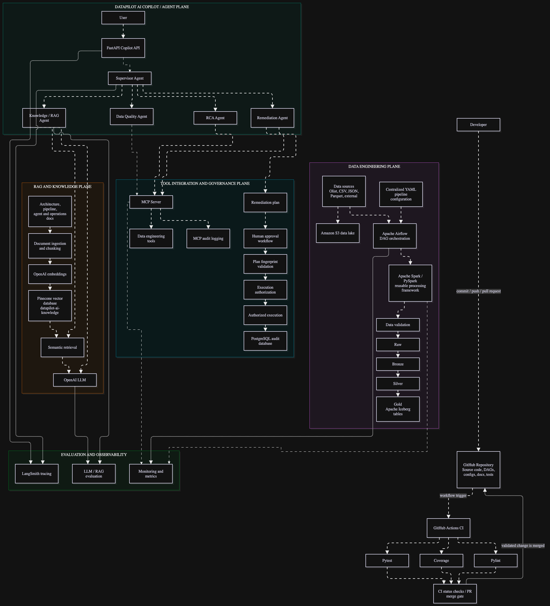
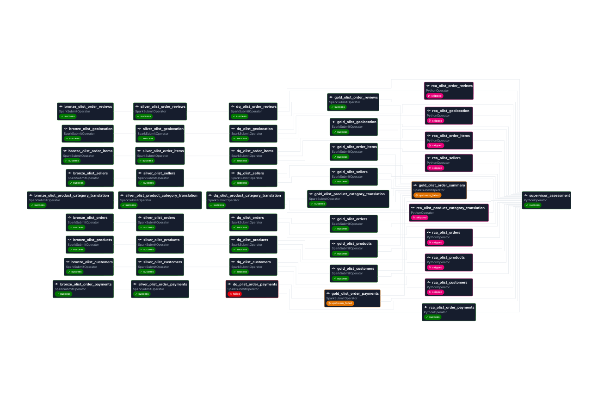
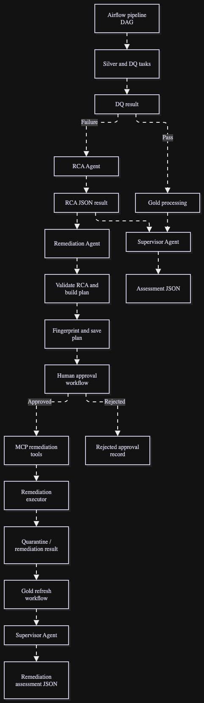
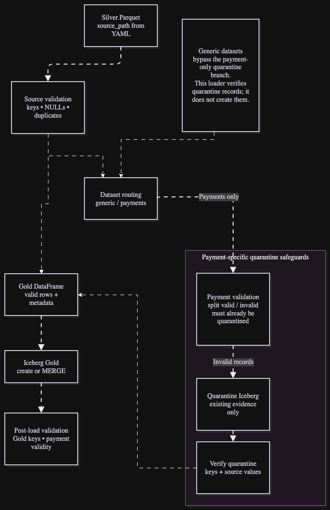
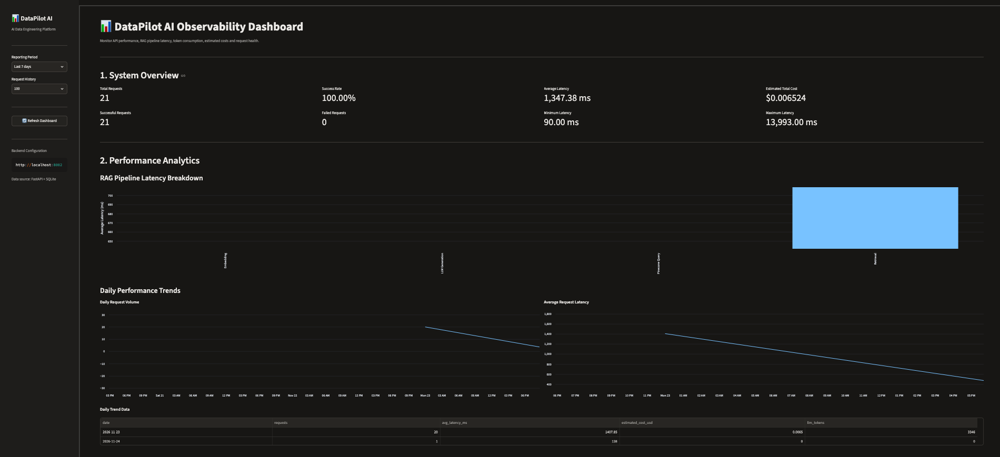
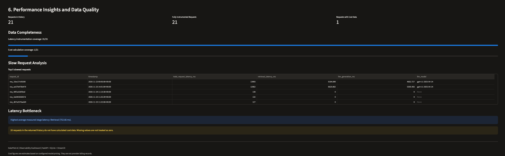
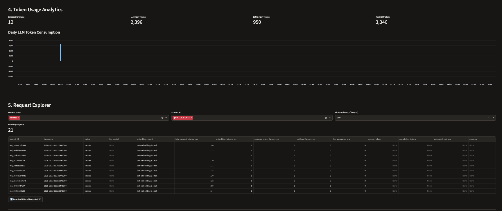
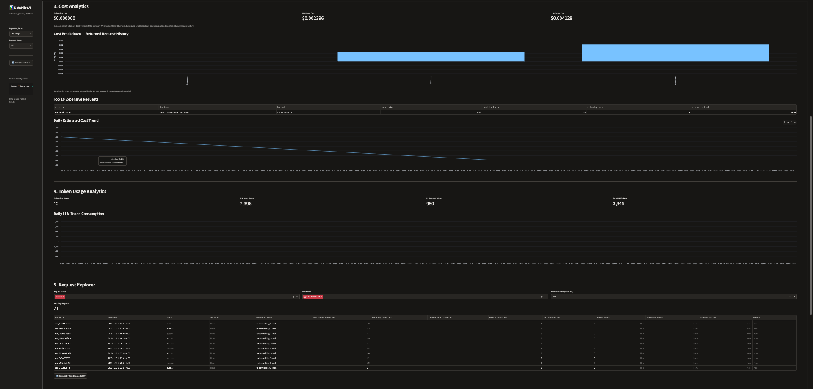

# DataPilot AI


**An AI-assisted data engineering and DataOps platform for reliable data pipelines, governed remediation, and operational intelligence.**


DataPilot AI demonstrates how a modern data platform can combine configuration-driven data engineering with AI agents and a retrieval-augmented Copilot. It is built around a practical e-commerce data scenario using the Olist dataset and is designed to show how teams can move from detecting a data problem to understanding it, planning a controlled response, and communicating the outcome.


> **Project positioning:** DataPilot AI is a locally runnable portfolio implementation. Its architecture includes AWS-oriented storage and catalog integrations, but cloud deployment is not claimed as completed. The Gold layer is configured to use **Apache Iceberg** tables; it should not be described as a Parquet Gold-table implementation.


## 1. Business problem


Data engineering teams are responsible for keeping data pipelines dependable and making trusted data available to analytics and downstream consumers. In a typical multi-stage pipeline, a failure or data-quality issue can create several operational problems:


- **Late detection:** invalid, incomplete, or inconsistent records may be discovered only after a pipeline stage fails or downstream data is questioned.

- **Slow investigation:** engineers often need to correlate DQ results, pipeline task states, dataset configuration, and historical operational information across different tools.

- **Manual root-cause analysis:** diagnosing why a dataset failed and deciding what to do next can require repeated investigation by experienced engineers.

- **Risky remediation:** directly changing or deleting bad records can damage trusted data if the action, scope, or approval is unclear.

- **Limited operational visibility:** pipeline status alone does not explain the business or data-quality impact, the likely cause, or the next recommended action.

- **Scattered engineering knowledge:** runbooks, architecture notes, and troubleshooting guidance are not always available in the context of an operational question.


The business case is to reduce the effort and risk involved in operating data pipelines by connecting data processing, data-quality checks, investigation, controlled remediation, operational assessment, and engineering knowledge in one demonstrable workflow.


DataPilot AI is a technical portfolio implementation of that approach. It does not claim measured production savings, reduced incident resolution time, or a quantified business ROI; those would require a production baseline and operational measurements.


## 2. How DataPilot AI addresses the problem

DataPilot AI combines a reusable data pipeline, specialized AI agents, and a RAG-powered Copilot. Each component has a defined responsibility, with controlled interactions and human approval for remediation.

| Operational challenge | DataPilot AI capability | How it helps |
|---|---|---|
| Repeated pipeline implementation | **Configuration-driven PySpark framework** | Reuses common readers, transformations, path construction, writers, and DQ execution across datasets. |
| Pipeline coordination | **Apache Airflow** | Orchestrates Bronze, Silver, DQ, RCA, Gold, and Supervisor workflow stages. |
| Data-quality failures | **Data Quality framework** | Applies configurable dataset rules and generates structured quality evidence. |
| Time-consuming investigation | **RCA Agent** | Analyzes failure evidence and produces root-cause findings with recommendations. |
| Unsafe or ambiguous data fixes | **Remediation Agent and approval workflow** | Generates fingerprinted remediation plans and separates human approval from execution. |
| Limited operational visibility | **Supervisor Agent** | Assesses pipeline and remediation outcomes and recommends next actions. |
| Manual technical documentation search | **RAG-powered Data Engineering Copilot** | Retrieves relevant engineering knowledge and generates contextual LLM responses through an API. |
| Fragmented tool access | **MCP server** | Exposes controlled inspection, approval, audit, and remediation operations to supported clients and agents. |


## 3. End-to-end solution flow


The platform demonstrates the following operational lifecycle:


1. **Ingest and process data.** Raw Olist datasets move through the Bronze and Silver processing stages using reusable PySpark components and centralized YAML configuration.

2. **Validate data quality.** Configured DQ rules evaluate processed datasets and record validation outcomes.

3. **Investigate failures.** When the relevant DQ failure path is reached, the RCA Agent uses the available evidence to produce a structured diagnosis.

4. **Prepare a remediation plan.** The Remediation Agent validates the RCA result and creates a remediation plan with a fingerprint and a pending-approval state.

5. **Apply governance controls.** The approval workflow records a human decision. The executor applies its own scope, approval, fingerprint, and execution-mode checks. A plan marked pending approval is not itself permission to write data.

6. **Assess operational outcomes.** The Supervisor Agent evaluates pipeline and remediation outcomes and produces a structured assessment. It does not replace the human approval boundary.

7. **Ask operational questions.** The Copilot retrieves relevant content from the knowledge base using Pinecone and generates an answer through the LLM integration, exposed by FastAPI.


The workflow is coordinated across Airflow, Python agents, the MCP server, the remediation executor, and the Copilot service. The components have separate responsibilities and explicit interfaces.


## 4. Architecture at a glance


The diagrams below use the project's existing visual assets so readers can understand the platform without needing to render Mermaid. All image paths are relative to the repository root and will render on GitHub when the \`images/\` directory is included. Keep the image filenames and folder structure unchanged when pushing the README.

**Architecture:** See [DataPilot AI Architecture](docs/architecture/architecture.md) for the detailed component design, data flows, agent responsibilities, MCP integration, and observability boundaries.


### Architecture




### Olist pipeline execution





### Agent interactions and governed remediation





### Gold layer: incremental processing with Apache Iceberg





### Copilot Observability Dashboard



**Performance and latency analytics**



**Token usage analytics**



**Cost analytics**



### Main technology areas


- **Orchestration and processing:** Apache Airflow, Apache Spark, PySpark.

- **Data layers:** Raw, Bronze, Silver, and Gold, driven by centralized configuration.

- **Gold table format:** Apache Iceberg.

- **Data quality:** reusable, configuration-driven PySpark DQ framework.

- **Agents:** RCA Agent, Remediation Agent, and Supervisor Agent.

- **Tool integration:** Model Context Protocol (MCP).

- **Copilot API:** FastAPI.

- **RAG:** document ingestion, chunking, OpenAI embeddings, Pinecone vector retrieval, and LLM response generation.

- **Local execution:** Docker Compose-based services.


## 5. Key capabilities


### Data engineering and DataOps


- Configuration-driven Bronze and Silver processing.

- Reusable PySpark framework components.

- Airflow orchestration across data processing and operational workflows.

- Configurable data-quality validation.

- Gold processing using Apache Iceberg tables.


### Agentic operations


- Structured RCA output based on data-quality failure evidence.

- Remediation plan generation with plan fingerprinting.

- Human approval and controlled execution boundaries.

- Supervisor assessment of pipeline and remediation outcomes.

- MCP tools for supported operational inspection and workflow actions.


### AI Data Engineering Copilot


- Ingestion of engineering documentation into a knowledge base.

- Chunking and embedding generation.

- Pinecone-backed vector retrieval.

- LLM-generated responses exposed through FastAPI.

- Retrieval evaluation to compare retrieval strategies and understand quality trade-offs.

### Observability and Cost Analytics

- End-to-end Copilot API request latency measurement.
- RAG stage-level latency tracking, including embedding, Pinecone query, retrieval, and LLM generation.
- Prompt, completion, and total token usage tracking.
- Estimated OpenAI embedding and LLM request costs.
- SQLite-based persistence of request-level observability metrics.
- Streamlit dashboard for latency, token usage, request statistics, and cost analysis.
- Request-level exploration and identification of high-cost and slow requests.

## Key Engineering Decisions

| Area | Decision | Rationale |
|---|---|---|
| Data processing | Configuration-driven Spark framework | Reusable processing across datasets without duplicating pipeline logic. |
| Data architecture | Bronze, Silver, and Gold layers | Separates ingestion, refinement, and analytical workloads. |
| Gold storage | Apache Iceberg | Supports table-level operations and incremental MERGE workflows. |
| Vector database | Pinecone | Provides managed vector storage for knowledge retrieval. |
| RAG evaluation | Similarity, MMR, and Multi-Query benchmarking | Evaluates retrieval quality rather than assuming one strategy is best. |
| Agent architecture | Separate RCA, Remediation, and Supervisor responsibilities | Maintains clear boundaries between diagnosis, execution, and assessment. |
| Remediation governance | Fingerprinted plans and human approval | Enforces explicit approval, fingerprint, and execution-scope checks, with documented security limitations. |
| Tool integration | MCP server | Exposes selected platform capabilities through a standard tool interface. |
| Deployment approach | Local-first portfolio implementation | Demonstrates workflows locally while keeping AWS deployment outside the current scope. |

DataPilot AI is currently demonstrated locally. AWS S3 and Glue are part of the target architecture.


## 6. Governance and safety by design


DataPilot AI separates diagnosis, planning, approval, and execution:


- The RCA Agent diagnoses; it does not authorize a write.

- The Remediation Agent creates a plan; a pending-approval plan is not execution authorization.

- Approval is a distinct workflow step and is tied to plan validation and fingerprint checks.

- The remediation executor applies additional scope and execution-mode safeguards.

- DRY_RUN and APPLY are distinct modes; write execution requires the applicable authorization controls.

- The Supervisor Agent assesses outcomes; it does not approve or execute remediation.


These controls demonstrate a governed remediation design. They do not by themselves establish production-grade identity management, authorization, or deployment security. See [Security and Governance](docs/architecture/security-and-governance.md) for documented boundaries and limitations.


## 7. Validation and evidence


The project includes automated tests and evaluation assets for the pipeline, agents, API, retrieval components, approval logic, and remediation safeguards. The latest recorded local audit reported **132 tests passed**, with one deprecation warning and seven subtests. Docker Compose configuration validation also passed in that audit.

The full local test suite was run on Python 3.14.7. CI validation on Python 3.11 covered a selected test subset, not the complete suite.


These are point-in-time results, not a claim that every production integration, cloud deployment, or real-world failure mode has been tested. Review the detailed [Testing and Validation Report](docs/operations/testing-and-validation.md) and [RAG Evaluation Report](docs/copilot/rag-evaluation.md) for scope, results, and limitations.


## 8. Running DataPilot AI Locally

DataPilot AI runs locally using Docker Compose. The platform includes Apache Airflow, Apache Spark, PostgreSQL, the MCP server, and the FastAPI-based AI Copilot.

### 8.1 Prerequisites

Install the following tools before starting:

| Requirement | Version / Configuration |
|---|---|
| Docker Desktop / Colima | Latest compatible version |
| Docker Compose | `docker-compose` |
| Python | 3.11 for CI and Copilot |
| Apache Airflow | 3.3.1 |
| Apache Spark | 4.1.3 |
| Java | 17 |
| AWS CLI | Configured AWS profile |
| OpenAI API | Valid API key |
| Pinecone | Configured API key and index |
| Git | Latest stable version |

### 8.2 Clone the repository

```bash
git clone https://github.com/prasanna1024kt/datapilot-ai.git
cd DataPilot-AI
```

Ensure Docker is running.

For Mac users running Colima:

```bash
colima start
docker info
```

### 8.3 Configure environment variables

Create a local `.env` file in the repository root.

Configure the required environment variables:

```env
# Application
DATAPILOT_ENV=local

# Airflow
AIRFLOW_FERNET_KEYRING=<YOUR_FERNET_KEY>

# AWS
AWS_PROFILE=datapilot
AWS_DEFAULT_REGION=us-east-1
AWS_ACCESS_KEY_ID=<YOUR_AWS_ACCESS_KEY>
AWS_SECRET_ACCESS_KEY=<YOUR_AWS_SECRET_KEY>

# OpenAI
OPENAI_API_KEY=<YOUR_OPENAI_API_KEY>

# Pinecone
PINECONE_API_KEY=<YOUR_PINECONE_API_KEY>

# LangSmith
LANGSMITH_API_KEY=<YOUR_LANGSMITH_API_KEY>
LANGSMITH_PROJECT=datapilot-ai
LANGSMITH_TRACING=false

# MCP Audit Database
MCP_AUDIT_DB_HOST=postgres
MCP_AUDIT_DB_PORT=5432
MCP_AUDIT_DB_NAME=<YOUR_AUDIT_DATABASE>
MCP_AUDIT_DB_USER=<YOUR_DATABASE_USER>
MCP_AUDIT_DB_PASSWORD=<YOUR_DATABASE_PASSWORD>
```

Configure the Pinecone index name and embedding settings according to the Copilot settings module.

Ensure AWS credentials are available through the configured AWS profile and mounted credentials directory.

**Security:** Never commit `.env`, API keys, AWS credentials, passwords, or other secrets to Git.

### 8.4 Validate Docker Compose configuration

Validate the Compose configuration before starting services.

```bash
docker-compose config -q
```

Expected result: successful configuration validation without errors.

### 8.5 Build Docker images

Build the Spark image first because the MCP server Dockerfile uses the Spark image as its base image.

```bash
# Build Spark image first
docker-compose build spark

# Build remaining project images
docker-compose build
```

The Docker Compose environment includes:

- PostgreSQL 16
- Airflow 3.3.1
- Spark 4.1.3
- MCP Server
- AI Copilot API

### 8.6 Start DataPilot AI services

Start the complete environment:

```bash
docker-compose up -d
```

Docker Compose manages the declared startup dependencies, including PostgreSQL initialization, Airflow services, Spark master/worker, and MCP.

Verify running containers:

```bash
docker-compose ps
```

View service logs:

```bash
docker-compose logs -f
```

To inspect an individual service:

```bash
docker-compose logs -f airflow
docker-compose logs -f spark-master
docker-compose logs -f mcp-server
docker-compose logs -f copilot
```

### 8.7 Access application services

Once the services are running, access the following endpoints:

| Component | URL |
|---|---|
| Airflow UI | http://localhost:8080 |
| Spark Master UI | http://localhost:8081 |
| MCP Server | http://localhost:8000 |
| AI Copilot API | http://localhost:8001 |
| Copilot Swagger UI | http://localhost:8001/docs |

Airflow credentials depend on the configured local authentication setup.

### 8.8 Execute data engineering pipelines

1. Open the Airflow UI.
2. Locate the DataPilot AI pipeline DAGs.
3. Select the required Olist pipeline.
4. Trigger the DAG.
5. Monitor task execution and logs.
6. Verify Bronze, Silver, and Gold outputs.

The processing framework uses centralized YAML configuration to manage datasets, storage paths, formats, and processing layers.

The data architecture follows:

```text
Raw
 |
 v
Bronze
 |
 v
Silver
 |
 v
Gold (Apache Iceberg)
```

AWS S3 access is required for workflows configured to read from or write to S3. The local Docker environment does not imply that DataPilot AI has been deployed to AWS.

### 8.9 Run RAG document ingestion

DataPilot AI uses document ingestion, chunking, OpenAI embeddings, and Pinecone vector storage to build its engineering knowledge base.

First, execute a dry run:

```bash
docker-compose exec copilot python -c \
'from copilot.rag.ingestion.ingestion_pipeline import RAGIngestionPipeline; print(RAGIngestionPipeline().ingest(directory="/app/docs", dry_run=True))'
```

The dry run validates document loading and chunk generation without making external embedding or vector database changes.

For an explicitly authorized live ingestion:

```bash
docker-compose exec copilot python -c \
'from copilot.rag.ingestion.ingestion_pipeline import RAGIngestionPipeline; print(RAGIngestionPipeline().ingest(directory="/app/docs", dry_run=False, allow_external_operations=True))'
```

This generates embeddings and upserts vectors into Pinecone.

The configured Pinecone namespace is:

```text
datapilot-ai
```

Verify the vector count using Pinecone index statistics.

### 8.10 Run AI Copilot

The AI Copilot exposes its functionality through FastAPI.

Access:

```text
http://localhost:8001/docs
```

Use the API documentation to explore the available Copilot endpoints.

The Copilot uses:

- OpenAI LLM integration
- RAG retrieval
- Pinecone vector search
- Engineering documentation
- Context-aware answer generation

### 8.11 Execute AI agents and MCP workflows

The MCP server exposes supported operational tools through:

```text
http://localhost:8000/mcp
```

The available tools support:

- Data-quality result inspection
- Bronze and Silver data inspection
- Invalid-record retrieval
- RCA investigation support
- Remediation approval and audit operations
- Supported remediation execution workflows

The Supervisor Agent coordinates agent activities and assesses operational outcomes.

### 8.12 Governed remediation workflow

DataPilot AI separates diagnosis, planning, approval, and execution.

The remediation lifecycle is:

```text
Data Quality Failure
        |
        v
    RCA Agent
        |
        v
 Remediation Agent
        |
        v
 Remediation Plan
        |
        v
 Human Approval
        |
        v
 Fingerprint Validation
        |
        v
 Authorized Execution
        |
        v
 PostgreSQL Audit
```

Remediation supports separate DRY_RUN and APPLY execution modes.

For portfolio demonstrations, use DRY_RUN and do not modify source data. APPLY must remain subject to the project's explicit approval, fingerprint, scope, and execution safeguards.

### 8.13 Run automated tests

Execute the complete test suite:

```bash
PYTHONPATH=. pytest -q
```

### 8.14 Generate test coverage

Run coverage analysis:

```bash
PYTHONPATH=. pytest -q \
  --cov=copilot \
  --cov=agents \
  --cov=mcp_server \
  --cov-report=term-missing \
  --cov-report=xml:coverage.xml
```

The XML report is generated as:

```text
coverage.xml
```

### 8.15 Run Pylint code quality checks

Install Pylint if it is not already installed:

```bash
pip install pylint
```

Run static code analysis:

```bash
PYTHONPATH=. pylint \
  copilot \
  agents \
  mcp_server \
  --fail-under=8.0 \
  --output-format=colorized
```

Pylint evaluates code quality, potential errors, conventions, and maintainability.

### 8.16 GitHub Actions CI

DataPilot AI uses GitHub Actions to automate three independent quality checks:

| Job | Responsibility |
|---|---|
| Pytest | Execute the complete configured test suite |
| Coverage | Generate test coverage reports |
| Pylint | Perform static code quality analysis |

CI is triggered through the configured GitHub branch and pull request workflows.

### 8.17 Stop and restart services

Stop running containers without deleting persistent data:

```bash
docker-compose down
```

Restart the environment:

```bash
docker-compose up -d
```

Check container status:

```bash
docker-compose ps
```

PostgreSQL data is maintained in the persistent Docker volume.

### 8.18 Important execution notes

- Keep API keys and credentials in local environment configuration.
- Verify service readiness before executing dependent workflows.
- Use non-production data for local demonstrations.
- Do not run APPLY remediation during routine portfolio demonstrations.
- AWS provisioning and deployment are outside the current project scope.
- Refer to the detailed deployment, architecture, security, and portfolio demonstration documentation for additional information.


## 9. Project status and scope


The project has completed its end-to-end data pipeline, Supervisor Agent, RCA v1 hardening, and Copilot/RAG implementation and integration testing, as recorded in the project’s latest status. The Copilot/RAG workflow includes ingestion, embedding, Pinecone retrieval, LLM response generation, and API exposure.


The project is presented as a **local portfolio implementation**. AWS deployment/provisioning is deferred and is not represented as completed. Cloud-oriented architecture references describe the intended integration pattern, not proof of a deployed cloud environment.


Production readiness is a separate assessment from functional completion. Authentication and authorization, deployment hardening, broader failure-mode testing, operational latency/cost measurement, and ongoing RAG quality regression controls should be evaluated against the intended production environment before making production-readiness claims.


## 10. Documentation


- [Architecture](docs/architecture/architecture.md)

- [HLD](docs/architecture/hld.md)

- [LLD](docs/architecture/lld.md)

- [Agent interactions](docs/architecture/agent-interactions.md)

- [RCA Agent](docs/agents/rca-agent.md)

- [Remediation Agent](docs/agents/remediation-agent.md)

- [Supervisor Agent](docs/agents/supervisor-agent.md)

- [Pipeline orchestration](docs/pipeline/pipeline-orchestration.md)

- [Spark framework](docs/pipeline/spark-framework.md)

- [Data quality](docs/pipeline/data-quality.md)

- [Gold processing](docs/pipeline/gold-processing.md)

- [MCP tools](docs/operations/mcp-tools.md)

- [Remediation workflow](docs/operations/remediation-workflow.md)

- [Configuration reference](docs/operations/configuration-reference.md)

- [Deployment and environment setup](docs/operations/deployment-and-environment-setup.md)

- [Testing and validation](docs/operations/testing-and-validation.md)

- [RAG evaluation](docs/copilot/rag-evaluation.md)

- [Portfolio demo walkthrough](docs/operations/portfolio-demo.md)

- [Security and governance](docs/architecture/security-and-governance.md)

- [Latency, Token Usage and Cost Observability](docs/operations/observability-latency-token-cost.md)


## 11. What this project demonstrates

The project includes local Copilot observability for request latency, RAG stage timings, token usage, and estimated LLM and embedding costs. Metrics are persisted in SQLite and presented through a Streamlit dashboard.

LangSmith tracing and local Copilot observability serve separate purposes and are documented independently.

The implementation is finalized as a local-first portfolio project. 
